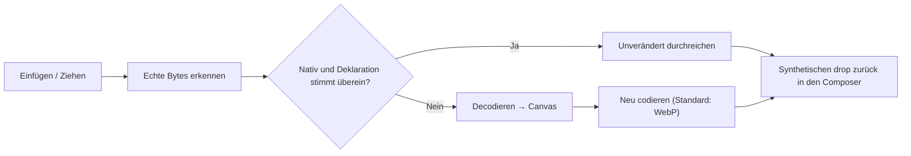

# dsh-paste-image

[](https://github.com/pengtang1024/dsh-paste-image/actions/workflows/ci.yml)
[](LICENSE)
[](https://www.npmjs.com/package/dsh-paste-image)
[](package.json)
[](CHANGELOG.md)

[简体中文](docs/DETAIL.zh.md) · [English](docs/DETAIL.en.md) · [Español](docs/DETAIL.es.md) · [Français](docs/DETAIL.fr.md) · [Deutsch](docs/DETAIL.de.md) · [Русский](docs/DETAIL.ru.md) · [Português](docs/DETAIL.pt.md)

Fügen Sie fast jedes Bild in DeepSeek Harness ein oder ziehen Sie es hinein – selbst wenn die Zwischenablage `image/xpm` meldet oder beim MIME-Typ lügt.

| Aktuelle Version | Standardausgabe | Laufzeitabhängigkeiten | Node-Anforderung |
| ---------------- | --------------- | ---------------------- | ---------------- |
| 0.6.1            | WebP            | keine                  | ≥ 20             |

> 📌 **Kurz gesagt:** Bytes sind wichtiger als Labels – das echte Format wird erkannt, im Renderer in ein Format auf der Whitelist konvertiert (standardmäßig WebP) und anschließend an den nativen Anhangkanal zurückgegeben.

## Schnellnavigation

| Was Sie tun möchten          | Hier geht es weiter                                                                                                                             |
| ---------------------------- | ----------------------------------------------------------------------------------------------------------------------------------------------- |
| Den Zweck verstehen          | [Warum es dieses Plugin gibt](#warum-es-dieses-plugin-gibt) · [So funktioniert es](#so-funktioniert-es) · [Formate](#unterstützte-formate)      |
| Installieren und loslegen    | [Installation](#installation) · [Funktion prüfen](#funktion-prüfen) · [Einstellungen](#einstellungen)                                           |
| Technische Details vertiefen | [Einschränkungen](#einschränkungen) · [Leistung](#leistung) · [Kompatibilität](#kompatibilität) · [Funktionsweise im Detail](docs/DETAIL.de.md) |
| Probleme lösen und mithelfen | [Sicherheit und Datenschutz](#sicherheit-und-datenschutz) · [Fehlerbehebung](docs/troubleshooting.md) · [Mitwirken](CONTRIBUTING.md)            |

## Warum es dieses Plugin gibt

Der DSH-Desktop-Client (Electron/Chromium) akzeptiert genau vier Anhangstypen: `image/png`, `image/jpeg`, `image/webp` und `image/gif`. Alles andere wird mit einer roten Fehlermeldung abgelehnt, die nur PNG, JPG, WebP und GIF aufführt:

> ⚠️ **Hinweis des Hosts:** Nur PNG, JPG, WebP und GIF werden unterstützt

Diese Whitelist macht zwei Dinge kaputt, die unter Linux ständig vorkommen:

- **Screenshots, die als XPM deklariert sind.** Manche Screenshot-Werkzeuge – insbesondere unter Ubuntu/Wayland – legen das Bild mit dem Typ `image/xpm` in die Zwischenablage. Die Pixel sind in Ordnung; die Bezeichnung steht nicht auf der Whitelist, also wird das Einfügen abgelehnt.
- **BMP-Bytes mit PNG-Etikett.** Manche Anwendungen übergeben eine BMP-(oder TIFF-)Nutzlast und deklarieren dabei `image/png`. Der deklarierte Typ besteht die Whitelist-Prüfung, der Decoder scheitert später, und es erscheint dieselbe rote Fehlermeldung.

`dsh-paste-image` behandelt beide Fälle im Renderer: Es sieht sich die tatsächlichen Bytes an, decodiert, was die Zwischenablage wirklich enthält, codiert das Ergebnis im gewählten Ausgabeformat (standardmäßig WebP) neu und gibt es an den normalen Anhangkanal zurück.

## So funktioniert es



1. **Abfangen.** `install()` registriert `paste`- und `drop`-Listener auf `document` in der Capture-Phase, sodass das Plugin das Ereignis sieht, bevor der Composer es verarbeitet.
2. **Erkennen.** `handle()` liest die `File`-Objekte aus `clipboardData` oder `dataTransfer`, und `sniff()` bestimmt das echte Format anhand der Magic Bytes – nicht anhand des deklarierten MIME-Typs.
3. **Neu codieren.** `normalize()` reicht native Dateien unverändert durch. Alles andere wird decodiert (eigene Pfade für XPM, BMP/DIB und SVG, für den Rest der browser-eigene Codec), auf eine Canvas gezeichnet, deren längste Seite auf 4096 px begrenzt ist, und im gewählten Ausgabeformat (standardmäßig WebP) exportiert; die Endung folgt dem tatsächlichen MIME-Typ (`.png`/`.jpg`/`.webp`).
4. **Umleiten.** `handle()` löst ein synthetisches `drop`-Ereignis mit der neuen `File` an `[data-composer-card]` aus – derselbe Weg, den ein echtes Drag-and-Drop nimmt. Eine Markierung `__dshPasteImageRerouted` verhindert, dass das Plugin sein eigenes Ereignis abfängt.

All das läuft clientseitig. Es gibt keinen Host-Prozess, kein Polling der Zwischenablage und keine Netzwerkanfrage.

## Unterstützte Formate

Diese Tabelle ist die Kurzfassung. Die vollständige Entscheidungskette, die BMP-Variantenmatrix und die bewusst ausgeschlossenen Formate finden Sie in der [Format-Referenz](docs/formats.md).

| Format                          | Üblicher deklarierter Typ | Was passiert                                                                                                                                       |
| ------------------------------- | ------------------------- | -------------------------------------------------------------------------------------------------------------------------------------------------- |
| PNG                             | `image/png`               | Unverändert durchgereicht                                                                                                                          |
| JPEG / JFIF                     | `image/jpeg`              | Unverändert durchgereicht                                                                                                                          |
| WebP                            | `image/webp`              | Unverändert durchgereicht                                                                                                                          |
| GIF                             | `image/gif`               | Unverändert durchgereicht                                                                                                                          |
| XPM (XPM3-Text)                 | `image/xpm`               | Wird von `decodeXpm()` decodiert, im gewählten Ausgabeformat neu codiert (standardmäßig WebP)                                                      |
| BMP / DIB                       | `image/bmp`               | Zuerst Browser-Decoder, `decodeBmp()` als Fallback: 1/4/8/16/24/32-Bit, RLE4/RLE8, BITFIELDS, OS/2-Header und headerlose DIBs                      |
| SVG                             | `image/svg+xml`           | Über ein ``-Element gerastert, im gewählten Ausgabeformat neu codiert (standardmäßig WebP)                                                    |
| ICO / CUR                       | `image/x-icon`            | Zuerst Browser-Decoder, dann Fallback auf den größten PNG-komprimierten Eintrag                                                                    |
| TIFF                            | `image/tiff`              | Anhand der Magic Bytes erkannt; nur decodiert, wenn der Browser einen TIFF-Codec mitbringt (Chromium nicht), sonst wird das Original durchgereicht |
| AVIF                            | `image/avif`              | Von Chromium decodiert, im gewählten Ausgabeformat neu codiert (standardmäßig WebP)                                                                |
| HEIC / HEIF, sonstige `image/*` | `image/...`               | Anhand der Magic Bytes erkannt; nur decodiert, wenn der Browser den Codec hat (Chromium decodiert kein HEIC), sonst durchgereicht                  |

Ein Durchreichen erfolgt nur, wenn die Magic Bytes zu einem der vier nativen Typen passen **und** der deklarierte Typ damit übereinstimmt. Eine Datei, deren Bytes JPEG sind, die aber `image/png` behauptet, wird im gewählten Ausgabeformat (standardmäßig WebP) neu codiert – der deklarierte Typ kann also nicht mehr lügen. Eine native Datei ganz ohne deklarierten Typ wird mit dem erkannten Typ neu verpackt, statt neu codiert zu werden; gängige Alias-Schreibweisen (`image/jpg`, `image/x-png`, `image/x-bmp`, `image/x-xpixmap`, `image/svg+xml`, …) gelten als Übereinstimmung.

Eine Datei wird überhaupt erst berücksichtigt, wenn ihr MIME-Typ mit `image/` beginnt oder ihr Name auf `.png`, `.jpg`, `.jpeg`, `.jfif`, `.gif`, `.webp`, `.bmp`, `.dib`, `.tif`, `.tiff`, `.xpm`, `.avif`, `.ico`, `.cur`, `.svg`, `.heic` oder `.heif` endet. Nicht-Bilddateien in derselben Einfügeaktion werden unverändert weitergeleitet.

## Installation

```bash
dsh plugin --profile <profile> add dsh-paste-image
```

Das Paket wird vorgebaut ausgeliefert – Renderer-Bundle, Host-Eintrag, Loader-Patch, Anzeige-Metadaten und mehrsprachige Dokumentation –, sodass die Installation es direkt aus der npm-Registry zieht. Sie können es auch direkt von GitHub installieren und die Registry umgehen:

```bash
dsh plugin --profile <profile> add github:pengtang1024/dsh-paste-image
```

Für die lokale Entwicklung können Sie das Profil auf Ihren Checkout zeigen lassen:

```bash
dsh plugin --profile <profile> add file:/absolute/path/to/dsh-paste-image
```

Ersetzen Sie `<profile>` durch das Profil, in dem Ihre App läuft.

> 🔄 **Nach der Installation die Seite neu laden** (`Ctrl+R`, unter macOS `Cmd+R`): Das Client-Modul wird nur beim Laden des Renderers eingeschleust; ohne Neuladen fängt das Plugin nichts ab.

**Host-Anforderungen:** DSH muss die im Paket deklarierte `engines.dsh` erfüllen (alle 0.2.x-Versionen ab 0.2.0-rc.2 bis vor 0.4.0), Node >= 20; die Versions-für-Version-Kompatibilität steht in `dsh.compatibility.dshReleases`. Ist die DSH-Version unpassend, wird das Plugin nicht geladen, und die Plugin-Detailseite zeigt einen entsprechenden Hinweis.

## Funktion prüfen

Führen Sie zuerst die Prüfungen des Repositorys aus:

```bash
cd dsh-paste-image
npm test
npm run check
```

`npm test` führt die Node-Testsuite aus: Magic-Byte-Erkennung, Kandidatenerkennung, jede BMP-Variante, die Konvertierung von als PNG deklarierten BMPs, headerlose DIBs, natives Durchreichen, die Konfigurationsseite und Laufzeit-Einstellungen sowie die für jede Sprache ausgelieferten Anzeige-Metadaten. `npm run check` prüft die Syntax von `client.js` und `lib/index.js`.

Prüfen Sie dann den echten Ablauf:

1. Laden Sie das DSH-Fenster neu.
2. Machen Sie mit Ihrem gewohnten Werkzeug einen Screenshot und fügen Sie ihn in den Composer ein, oder ziehen Sie eine Bilddatei darauf ab.
3. Der Anhang erscheint. Öffnen Sie die DevTools (`Ctrl+Shift+I`) → Console, stellen Sie die Stufe auf **Verbose** und suchen Sie eine Zeile wie:

```text
[dsh-paste-image] image/xpm -> image/png 1440x900
```

Schlägt die Konvertierung fehl, behält das Plugin die Originaldatei und protokolliert stattdessen `keep original (...)`.

## Einstellungen

Die Einstellungen des Plugins liegen jetzt unter **Einstellungen → Beliebiges Bild einfügen** und öffnen direkt das vollständige Formular. Der bisherige Eintrag über die Plugin-Zeile bleibt erhalten: **Einstellungen → Erweiterungen → dsh-paste-image → Konfiguration**; die Plugin-Zeile zeigt außerdem eine einzeilige Zusammenfassung (aktiviert / deaktiviert), die zum selben Formular führt. Beide Einträge teilen sich dieselben Einstellungen – eine Änderung genügt. Die Standardwerte entsprechen dem Verhalten vor der Einführung der Konfigurationsseite:

| Feld                    | Standard | Wert / Verhalten                                                                                                                      |
| ----------------------- | -------- | ------------------------------------------------------------------------------------------------------------------------------------- |
| Plugin aktivieren       | An       | Wenn aus, kehrt `handle()` sofort zurück; Einfügen und Ziehen laufen vollständig nativ (Listener bleiben, Reaktivierung wirkt sofort) |
| Max. Dateien pro Aktion | 8        | 1–8; größere Stapel werden insgesamt dem nativen Pfad überlassen                                                                      |
| Maximale Kantenlänge    | 4096     | 512–8192; betrifft nur konvertierte Bilder, nativ durchgereichte Dateien werden nicht skaliert                                        |
| Ausgabeformat           | WebP     | PNG / JPEG / WebP; Codierformat der Konvertierung                                                                                     |
| Qualität                | 0.92     | 0.1–1, nur für JPEG / WebP; bei Auswahl von PNG ist das Feld deaktiviert                                                              |
| XPM konvertieren        | An       | Wenn aus, wird `image/xpm` nicht konvertiert und unverändert an den nativen Kanal übergeben                                           |
| BMP / DIB konvertieren  | An       | Wenn aus, werden BMP/DIB (auch Dateien mit BMP-Bytes und PNG-Deklaration) unverändert durchgereicht                                   |
| SVG konvertieren        | An       | Wenn aus, wird SVG nicht gerastert und unverändert an den nativen Kanal übergeben                                                     |
| ICO / CUR konvertieren  | An       | Wenn aus, werden Icons nicht konvertiert und unverändert an den nativen Kanal übergeben                                               |
| Konvertierungs-Logs     | An       | Wenn aus, werden keine `console.debug`-Meldungen wie `[dsh-paste-image] ...` ausgegeben                                               |

> 💡 **Wann wirksam:** Erst **Speichern** schreibt die Einstellungen und wendet sie sofort an; Änderungen im Formular sind nur Entwürfe und werden beim Verlassen der Seite verworfen. **Standard wiederherstellen** setzt alle Werte der obigen Tabelle zurück und wirkt ebenfalls sofort. Zahlenfelder werden gerundet und auf den erlaubten Bereich begrenzt (ein leeres Feld setzt den gespeicherten Wert nicht auf 0).

Standard ist WebP: WebP bewahrt Transparenz und ist zugleich kompakt; PNG ist verlustfrei; JPEG ist kleiner, komponiert vor dem Codieren aber transparente Pixel auf Weiß. Unterstützt der Browser den gewählten Encoder nicht, wird auf den tatsächlichen Codiertyp zurückgegriffen; ist dieser nicht erkennbar, auf PNG – ohne Formatwechsel bleibt die Konvertierung also bei der Standardausgabe WebP.

Wie viel Platz tatsächlich gespart wird, hängt vom Bildinhalt ab (q=0.92, in KB, 1 KB = 1000 B):

| Inhalt             | Abmessung | PNG    | JPEG                            | WebP  |
| ------------------ | --------- | ------ | ------------------------------- | ----- |
| UI-Screenshot      | 1440×900  | 69.7   | 103.6                           | 33.9  |
| Foto               | 1600×1200 | 3535.3 | 649.3                           | 628.0 |
| Transparentes Logo | 512×512   | 349.1  | 25.8 (weißer Grund, kein Alpha) | 56.6  |
| Pixelgrafik        | 256×256   | 4.1    | 2.9                             | 2.9   |

Fotos sind mit JPEG/WebP rund 82 % kleiner, während UI-Screenshots und Pixelgrafiken mit PNG oft kleiner sind; bei transparenten Bildern sollten Sie JPEG nicht wählen. Umgebung, Methode, Laufzeiten und der Vergleich mit q=0.8 finden Sie in den [vollständigen Messwerten](docs/output-formats.md).

Die Einstellungen werden nur im `localStorage` des aktuellen Browsers gespeichert (Schlüssel `dsh-paste-image.settings.v1`): kein Upload, kein Schreiben in den Host und keine Synchronisierung über Browser oder Profile hinweg. Im privaten Modus oder wenn `localStorage` nicht verfügbar ist, wird auf den Speicher zurückgegriffen und nach dem Neuladen gelten wieder die Standardwerte. Nach dem Speichern ist kein Neuladen nötig – die nächste Einfügeaktion nutzt die neuen Werte.

## Einschränkungen

- **XPM:** nur das XPM3-Textformat. Der Parser liest den Farbschlüssel `c`; andere Schlüssel wie `m`, `g` und `s` werden ignoriert. Farben werden vom CSS-Parser des Browsers aufgelöst; Palettennamen, die keine gültigen CSS-Farben sind – etwa das mehrteilige `light gray` –, fallen daher auf opakes Schwarz zurück.
- **BMP:** 1/4/8/16/24/32-Bit, `BI_RGB`, `BI_RLE8`, `BI_RLE4`, `BI_BITFIELDS` und `BI_ALPHABITFIELDS`, mit Core-, Extended-, V4/V5- oder OS/2-Headern – dazu headerlose DIBs. 2-Bit- und 64-Bit-pro-Pixel-Varianten werden nicht unterstützt. Bei 32-Bit-Dateien ohne deklarierte Alpha-Maske wird ein durchgehend Null-Alphakanal als opak behandelt, statt ein vollständig transparentes PNG zu erzeugen.
- **Andere Codecs:** SVG wird im Plugin selbst gerastert; ICO/CUR fallen auf PNG-komprimierte Einträge zurück; AVIF setzt auf den Browser-Decoder. TIFF und HEIC werden erkannt, aber Chromium liefert keinen Codec dafür mit, sodass das Original durchgereicht wird und der Host es wie zuvor ablehnt. Es wird kein Decoder von Drittanbietern mitgeliefert.
- **Größe:** konvertierte Bilder werden auf höchstens 4096 px auf der längsten Seite herunterskaliert (in den [Einstellungen](#einstellungen) anpassbar). Nativ unverändert durchgereichte Dateien werden nicht skaliert.
- **Anzahl:** eine Einfüge- oder Drop-Aktion darf höchstens 8 Dateien enthalten (in den [Einstellungen](#einstellungen) anpassbar). Größere Stapel werden vollständig dem nativen Pfad überlassen.
- **Flattening:** ein konvertiertes Bild wird zu einem einzelnen Standbild im gewählten Ausgabeformat (standardmäßig WebP). Animationen, EXIF-Metadaten und eingebettete Farbprofile bleiben nicht erhalten.
- **Umfang:** Es werden nur die Pfade `paste` und `drop` abgedeckt. Der Dateiauswahldialog und andere Einfügewege behalten ihr natives Verhalten.

## Leistung

0.3.1 brachte gemessene Optimierungen des Hot Paths; die Zahlen stammen aus `bench/bench.mjs`, auf derselben Maschine mit Node 24:

| Szenario                             | 0.3.0                                                           | 0.3.1                                                    |
| ------------------------------------ | --------------------------------------------------------------- | -------------------------------------------------------- |
| Native PNG-Durchreichung (20 MiB)    | 3.803–3.929 ms/op; liest jedes Mal 20,971,520 Bytes vollständig | 0.0038–0.0063 ms/op; liest 0 Bytes vollständig           |
| XPM-Decodierung (512×512, 64 Farben) | 4.712–4.837 ms/op                                               | 3.35–3.95 ms/op (ca. -24 %, Messbereich -18 % bis -29 %) |
| BMP→PNG-Konvertierung (1024×1024)    | ca. 3.9–4.0 ms/op                                               | ca. 3.9–4.0 ms/op, unverändert                           |
| `decodeBmp` (24/32-Bit, RLE8)        | —                                                               | innerhalb des Rauschens unverändert                      |

`normalize()` liest nun zuerst mit `file.slice()` höchstens 1 KiB Header zum Erkennen. Passt das Ergebnis zu einem nativen Format (PNG/JPEG/WebP/GIF) und stimmt der deklarierte MIME-Typ überein, wird die Datei direkt zurückgegeben, ohne sie vollständig in den Speicher zu lesen. Erst wenn der Typ neu markiert (leere Deklaration) oder wirklich konvertiert werden muss, wird auf das vollständige `arrayBuffer()` zurückgegriffen. `resolveColor()` nutzt eine 1×1-Canvas wieder, und XPM verwendet eine Map von Zeichencodes, wenn auf Einzelzeichen codiert wird, statt `row.slice()` pro Pixel. BMP-Decodierung und Konvertierung blieben unverändert.

Die Optimierung betrifft nur diesen synchronen Renderer-Code: keine neuen Worker, keine Netzwerkanfragen und keine Änderung am Zeitpunkt der Verarbeitung. Der Benchmark lässt sich mit `npm run bench` (oder `npm run bench -- --quick`) lokal nachfahren; die im Repository notierten Zahlen sind Richtwerte, keine CI-Grenzwerte.

## Kompatibilität

Das Plugin richtet sich nach den Renderer-APIs moderner Chromium-/Electron-Versionen: `File`/`Blob`, `TextDecoder`, `createImageBitmap`, `canvas.toBlob`, `DataTransfer`/`DragEvent` sowie `addEventListener` mit `signal`. Auf dieser Basis gibt es vier explizite Rückfälle, damit das Plugin bei einem fehlenden API nicht komplett ausfällt oder native Ereignisse verschluckt:

| Fehlende Fähigkeit           | Rückfallverhalten                                                                                                  |
| ---------------------------- | ------------------------------------------------------------------------------------------------------------------ |
| `AbortController`            | `install()` registriert Listener ohne `signal`; der Disposer entfernt sie genau mit `removeEventListener`          |
| `canvas.toBlob`              | `encodeCanvas()` fällt auf `toDataURL()` zurück und dekodiert die Base64-Daten in ein `Blob`                       |
| `DataTransfer` / `DragEvent` | `handle()` kehrt vor dem Claim und `preventDefault()` zurück; der native Paste-/Drop-Pfad bleibt völlig unberührt  |
| `[data-composer-card]`       | `handle()` kehrt ohne Ziel direkt zurück: kein Claim, kein `preventDefault()`, natives Einfügen bleibt unverändert |

`File`-ähnliche Objekte ohne `slice()`/`size` können den Header nicht auslesen und greifen auf den ursprünglichen vollständigen Lesepfad zurück. Die CI läuft die gesamte Testsuite auf Node 20, 22 und 24 und zusätzlich einen Smoke-Test mit `bench/bench.mjs --quick`; derzeit sind es 102 Tests, die headerlose DIBs, 1/4/8/16/24/32-Bit-BMP, RLE4/RLE8, BITFIELDS, OS/2-Core-Header, TIFF-/HEIC-/AVIF-Erkennung, MIME-Alias-Durchreichung, BMP-Bytes mit PNG-Deklaration, das 8-Dateien-Limit, Durchreichen von Nicht-Bildern, die vier Rückfallpfade sowie die Registrierung der Konfigurationsseite und das Einstellungsverhalten abdecken. Plattformunterschiede und Browser-Abhängigkeiten pro Format finden Sie unter [Formatunterstützung](docs/formats.md).

## Sicherheit und Datenschutz

- Alles läuft im Renderer. Das Plugin stellt keine Netzwerkanfragen, lädt nichts hoch und speichert nichts.
- Es gibt keinen Hintergrundprozess, kein Polling der Zwischenablage und keine Änderung am DSH-Host-Code.
- Bild-Bytes werden ausschließlich aus dem Paste- oder Drop-Ereignis gelesen, lokal decodiert und an dasselbe Fenster zurückgegeben.
- Die Decoder sind klein, verarbeiten aber nicht vertrauenswürdige Eingaben. Wenn Sie einen Absturz oder einen Parsing-Fehler finden, sehen Sie in [SECURITY.md](SECURITY.md) nach.

## Sprachen

Das Plugin liefert Anzeige-Metadaten für jede Sprache, die die DSH-Oberfläche unterstützt – vereinfachtes Chinesisch, Englisch, Spanisch, Französisch, Deutsch, Russisch und Portugiesisch. Jede Datei `locale/<language>.json` enthält den lokalisierten Titel und die Beschreibung und verweist mit ihrer Detailseite auf das passende README in diesem Repository, sodass der Plugin Manager und seine Detailseite dieselbe Sprache sprechen wie die App.

**Vereinfachtes Chinesisch ist die Quellsprache.** Diese README, die Dokumente unter `docs/` sowie `CONTRIBUTING.md`, `CHANGELOG.md` und `SECURITY.md` sind auf Chinesisch verfasst; die übrigen Sprachen sind Übersetzungen, darunter Englisch als `README.en.md` und `docs/en/`. Übersetzungen werden als Quelldateien neben dem Code gepflegt, nicht zur Laufzeit maschinell übersetzt. Die Testsuite prüft, dass jede angekündigte Sprache eine Locale-Datei, ein Detaildokument und gegenseitige Links zwischen den READMEs hat. Wie Sie eine Übersetzung korrigieren oder hinzufügen, steht unter [Mitwirken](CONTRIBUTING.en.md#translations).

## Dokumentation

- [Funktionsweise im Detail](docs/DETAIL.de.md) – Ereignisfluss, Decoder-Interna und eine Code-Landkarte Funktion für Funktion.
- [Formatunterstützung](docs/formats.md) – Entscheidungskette, Formatmatrix, BMP-Varianten und die Checkliste zum Hinzufügen eines Formats.
- [Messwerte der Ausgabeformate](docs/output-formats.md) – Größe und Codierzeit von PNG / JPEG / WebP, nach Bildinhalt aufgeschlüsselt.
- [Fehlerbehebung](docs/troubleshooting.md) – typische Fehler und wie man die Logs liest.
- [Veröffentlichen](docs/releasing.md) – Versionsrichtlinie und die Release-Checkliste für Maintainer.

## Community

- [Mitwirken](CONTRIBUTING.md) – Einrichtung, Tests, Stil, Übersetzungen und was ein Format-Beitrag braucht.
- [Verhaltenskodex](CODE_OF_CONDUCT.md) – Contributor Covenant 2.1.
- [Sicherheitsrichtlinie](SECURITY.md) – vertrauliche Meldung, Umfang und unterstützte Versionen.
- [Changelog](CHANGELOG.md) und [Releases](https://github.com/pengtang1024/dsh-paste-image/releases) – was sich geändert hat und warum.
- [Issues](https://github.com/pengtang1024/dsh-paste-image/issues) – Fehlerberichte und Formatwünsche.

## Lizenz

MIT © 2026 pengtang1024. Siehe [LICENSE](LICENSE).

## Unterstützen Sie dieses Projekt

Wenn Ihnen das Plugin im Alltag hilft, geben Sie [dsh-paste-image](https://github.com/pengtang1024/dsh-paste-image) doch einen Stern ⭐. Ein kleiner Klick motiviert mich sehr, es weiter zu pflegen.
