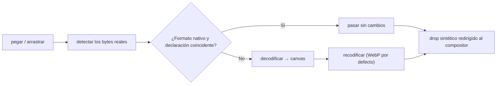

# dsh-paste-image

[](https://github.com/pengtang1024/dsh-paste-image/actions/workflows/ci.yml)
[](LICENSE)
[](https://www.npmjs.com/package/dsh-paste-image)
[](package.json)
[](CHANGELOG.md)

[简体中文](docs/DETAIL.zh.md) · [English](docs/DETAIL.en.md) · [Español](docs/DETAIL.es.md) · [Français](docs/DETAIL.fr.md) · [Deutsch](docs/DETAIL.de.md) · [Русский](docs/DETAIL.ru.md) · [Português](docs/DETAIL.pt.md)

Pega o arrastra casi cualquier imagen en DeepSeek Harness, incluso cuando el portapapeles dice `image/xpm` o miente sobre el tipo MIME.

| Versión actual | Salida predeterminada | Dependencias en tiempo de ejecución | Requisito de Node |
| -------------- | --------------------- | ----------------------------------- | ----------------- |
| 0.6.1          | WebP                  | Ninguna                             | ≥ 20              |

> 📌 **En una frase:** los bytes prevalecen sobre la etiqueta: detecta el formato real, lo recodifica en el renderer al formato permitido (WebP por defecto) y lo devuelve al canal de adjuntos nativo.

## Guía rápida

| Qué quieres hacer       | Dónde ir                                                                                                                                   |
| ----------------------- | ------------------------------------------------------------------------------------------------------------------------------------------ |
| Entender para qué sirve | [Por qué existe](#por-qué-existe) · [Cómo funciona](#cómo-funciona) · [Formatos compatibles](#formatos-compatibles)                        |
| Instalarlo y usarlo     | [Instalación](#instalación) · [Cómo verificar que funciona](#cómo-verificar-que-funciona) · [Ajustes](#ajustes)                            |
| Profundizar en detalles | [Limitaciones](#limitaciones) · [Rendimiento](#rendimiento) · [Compatibilidad](#compatibilidad) · [Cómo funciona](docs/en/how-it-works.md) |
| Resolver y contribuir   | [Seguridad y privacidad](#seguridad-y-privacidad) · [Solución de problemas](docs/en/troubleshooting.md) · [Contribuir](CONTRIBUTING.en.md) |

## Por qué existe

El cliente de escritorio de DSH (Electron/Chromium) acepta exactamente cuatro tipos de adjunto: `image/png`, `image/jpeg`, `image/webp` e `image/gif`. Cualquier otro se rechaza con un error en rojo:

> ⚠️ **Aviso del host:** solo se admiten PNG, JPG, WebP y GIF

Esa lista blanca rompe dos situaciones que ocurren todo el tiempo en Linux:

- **Capturas declaradas como XPM.** Algunas herramientas de captura, sobre todo en Ubuntu/Wayland, dejan la imagen en el portapapeles con el tipo `image/xpm`. Los píxeles están bien; la etiqueta no está en la lista blanca, así que el pegado se rechaza.
- **Bytes BMP con etiqueta PNG.** Algunas aplicaciones entregan un BMP (o TIFF) mientras declaran `image/png`. El tipo declarado pasa la lista blanca, el decodificador falla más adelante y aparece el mismo error en rojo.

`dsh-paste-image` resuelve ambos casos dentro del renderer: mira los bytes reales, decodifica lo que el portapapeles contiene de verdad, lo recodifica en el formato de salida elegido (WebP por defecto) y devuelve el resultado al canal de adjuntos normal.

## Cómo funciona



1. **Captura.** `install()` registra los listeners `paste` y `drop` sobre `document` en la fase de captura, así el plugin ve el evento antes que el cuadro de entrada.
2. **Detección.** `handle()` lee los objetos `File` de `clipboardData` o `dataTransfer`, y `sniff()` identifica el formato real a partir de los bytes mágicos, no del tipo MIME declarado.
3. **Recodificación.** `normalize()` deja pasar intactos los cuatro formatos nativos; todo lo demás se decodifica (rutas dedicadas para XPM, BMP/DIB y SVG; el códec propio del navegador para el resto), se dibuja en un canvas con el lado más largo limitado a 4096 px y se exporta en el formato de salida elegido (WebP por defecto); la extensión sigue el MIME real (`.png`/`.jpg`/`.webp`).
4. **Redirección.** `handle()` despacha un evento `drop` sintético que lleva el nuevo `File` a `[data-composer-card]`, que es el mismo camino que toma un arrastrar y soltar real. Un marcador `__dshPasteImageRerouted` impide que el plugin intercepte su propio evento.

Todo esto ocurre en el cliente. No hay proceso anfitrión, ni sondeo del portapapeles, ni peticiones de red.

## Formatos compatibles

Esta tabla es la versión corta. La [referencia de soporte de formatos](docs/en/formats.md) explica el flujo de decisión, la grilla completa de variantes de BMP y lo que queda intencionalmente fuera de alcance.

| Formato                      | Tipo declarado habitual | Qué ocurre                                                                                                                                                     |
| ---------------------------- | ----------------------- | -------------------------------------------------------------------------------------------------------------------------------------------------------------- |
| PNG                          | `image/png`             | Se deja pasar sin cambios                                                                                                                                      |
| JPEG / JFIF                  | `image/jpeg`            | Se deja pasar sin cambios                                                                                                                                      |
| WebP                         | `image/webp`            | Se deja pasar sin cambios                                                                                                                                      |
| GIF                          | `image/gif`             | Se deja pasar sin cambios                                                                                                                                      |
| XPM (texto XPM3)             | `image/xpm`             | Se decodifica con `decodeXpm()` y se recodifica en el formato de salida elegido (WebP por defecto)                                                             |
| BMP / DIB                    | `image/bmp`             | Primero decodifica el navegador; si falla, `decodeBmp()`: 1/4/8/16/24/32 bits, RLE4/RLE8, BITFIELDS, cabeceras OS/2 y DIB sin cabecera                         |
| SVG                          | `image/svg+xml`         | Se rasteriza mediante un elemento `` y se recodifica en el formato de salida elegido (WebP por defecto)                                                   |
| ICO / CUR                    | `image/x-icon`          | Primero decodifica el navegador; si falla, se usa la entrada PNG comprimida más grande                                                                         |
| TIFF                         | `image/tiff`            | Se detecta por los bytes mágicos; se decodifica solo si el navegador incluye un códec TIFF (Chromium no lo incluye); de lo contrario se deja pasar el original |
| AVIF                         | `image/avif`            | Lo decodifica Chromium y se recodifica en el formato de salida elegido (WebP por defecto)                                                                      |
| HEIC / HEIF, otros `image/*` | `image/...`             | Se detecta por los bytes mágicos; se decodifica solo cuando el navegador tiene el códec (Chromium no decodifica HEIC); de lo contrario se deja pasar           |

El paso sin cambios solo ocurre cuando los bytes mágicos coinciden con uno de los cuatro tipos nativos **y** el tipo declarado concuerda. Un archivo cuyos bytes son JPEG pero que declara `image/png` se recodifica en el formato de salida elegido (WebP por defecto), de modo que el tipo declarado ya no puede mentir. Un archivo nativo sin ningún tipo declarado se vuelve a envolver con el tipo detectado en lugar de recodificarse, y las grafías alias habituales (`image/jpg`, `image/x-png`, `image/x-bmp`, `image/x-xpixmap`, `image/svg+xml`, …) cuentan como concordancia.

Un archivo se toma en cuenta cuando su tipo MIME empieza por `image/` o su nombre termina en `.png`, `.jpg`, `.jpeg`, `.jfif`, `.gif`, `.webp`, `.bmp`, `.dib`, `.tif`, `.tiff`, `.xpm`, `.avif`, `.ico`, `.cur`, `.svg`, `.heic` o `.heif`. Los archivos que no son imágenes en el mismo pegado se reenvían intactos.

## Instalación

```bash
dsh plugin --profile <profile> add dsh-paste-image
```

El paquete se distribuye ya compilado —bundle del renderer, entrada del host, parche del loader, metadatos de presentación y documentación multilingüe—, así que la instalación lo trae directamente del registro de npm. También puedes instalarlo desde GitHub, sin pasar por el registro:

```bash
dsh plugin --profile <profile> add github:pengtang1024/dsh-paste-image
```

Para desarrollo local, apunta el perfil a tu copia de trabajo:

```bash
dsh plugin --profile <profile> add file:/absolute/path/to/dsh-paste-image
```

Reemplaza `<profile>` por el perfil con el que corre tu aplicación.

> 🔄 **Recarga la página después de instalar** (`Ctrl+R`, o `Cmd+R` en macOS): el módulo de cliente solo se inyecta cuando carga el renderer, así que un plugin recién instalado no intercepta nada hasta que recargues.

**Requisitos del host:** DSH debe cumplir el rango `engines.dsh` declarado en el paquete (versiones 0.2.x desde 0.2.0-rc.2 y anteriores a 0.4.0) y Node >= 20; la compatibilidad por versión se declara en `dsh.compatibility.dshReleases`. Si la versión de DSH no cumple, el plugin no se carga y la página de detalles del plugin lo indica.

## Cómo verificar que funciona

Ejecuta primero las comprobaciones del repositorio:

```bash
cd dsh-paste-image
npm test
npm run check
```

`npm test` ejecuta la suite de pruebas de Node: detección de bytes mágicos, detección de candidatos, cada variante de BMP, la conversión de bytes BMP que declaran ser PNG, DIB sin cabecera, el paso intacto de archivos nativos, la página de ajustes y sus parámetros en tiempo de ejecución, y los metadatos de presentación de cada idioma. `npm run check` verifica la sintaxis de `client.js` y `lib/index.js`.

Luego comprueba el flujo real:

1. Recarga la ventana de DSH.
2. Haz una captura con tu herramienta habitual y pégala en el cuadro de entrada, o arrastra un archivo de imagen sobre él.
3. El adjunto aparece. Abre DevTools (`Ctrl+Shift+I`) → Console, cambia el nivel a **Verbose** y busca una línea como:

```text
[dsh-paste-image] image/xpm -> image/png 1440x900
```

Si la conversión falla, el plugin conserva el archivo original y en su lugar registra `keep original (...)`.

## Ajustes

Los ajustes del plugin están ahora en **Ajustes → Pegar cualquier imagen**, que abre directamente el formulario completo. La entrada anterior en la fila del plugin sigue disponible: **Ajustes → Extensiones → dsh-paste-image → Configuración**; la fila del plugin muestra además un resumen de una línea (activado / desactivado) que lleva al mismo formulario. Ambas entradas comparten los mismos ajustes, así que basta con cambiar una. Los valores predeterminados equivalen al comportamiento anterior a la existencia de la página de ajustes:

| Campo                  | Valor predeterminado | Rango / comportamiento                                                                                                                               |
| ---------------------- | -------------------- | ---------------------------------------------------------------------------------------------------------------------------------------------------- |
| Activar el plugin      | Activado             | Si se desactiva, `handle()` sale de inmediato y pegar/arrastrar va completamente por la ruta nativa (los listeners siguen, reactivar es instantáneo) |
| Máximo de archivos     | 8                    | 1–8; un lote mayor se entrega entero a la ruta nativa                                                                                                |
| Límite del lado largo  | 4096                 | 512–8192; solo afecta a las imágenes convertidas, los archivos nativos no se redimensionan                                                           |
| Formato de salida      | WebP                 | PNG / JPEG / WebP; codificación usada para la salida convertida                                                                                      |
| Calidad                | 0.92                 | 0.1–1, solo para JPEG / WebP; el campo se desactiva al elegir PNG                                                                                    |
| Convertir XPM          | Activado             | Al desactivarlo, `image/xpm` no se convierte y va intacto al canal nativo                                                                            |
| Convertir BMP / DIB    | Activado             | Al desactivarlo, BMP/DIB (incluidos los archivos con bytes BMP que declaran PNG) pasan sin cambios                                                   |
| Convertir SVG          | Activado             | Al desactivarlo, SVG no se rasteriza y va intacto al canal nativo                                                                                    |
| Convertir ICO / CUR    | Activado             | Al desactivarlo, los iconos no se convierten y van intactos al canal nativo                                                                          |
| Registrar conversiones | Activado             | Al desactivarlo, no se imprimen las líneas `console.debug` de `[dsh-paste-image] ...`                                                                |

> 💡 **Cómo se aplica:** solo **Guardar** escribe y aplica los valores al instante; los cambios en el formulario son un borrador dentro de la página y se descartan al salir. **Restaurar valores predeterminados** vuelve a escribir todos los valores de la tabla y los aplica igualmente de inmediato. Las entradas numéricas se redondean y se limitan a su rango (vaciar un campo no sobrescribe el valor guardado con 0).

WebP es la salida predeterminada: conserva la transparencia y mantiene un tamaño reducido. PNG es sin pérdidas; JPEG produce archivos más pequeños, pero compone los píxeles transparentes sobre un fondo blanco antes de codificar. Cuando el navegador no puede codificar el formato elegido, el plugin recurre al tipo que realmente produjo y a PNG si ese tipo no se reconoce; la tabla de formatos de arriba sigue describiendo la salida WebP predeterminada si no cambias de formato.

Lo mucho que se ahorra depende del contenido de la imagen (q=0.92, tamaños en KB, 1 KB = 1000 B):

| Contenido           | Dimensiones | PNG    | JPEG                                    | WebP  |
| ------------------- | ----------- | ------ | --------------------------------------- | ----- |
| Captura de interfaz | 1440×900    | 69.7   | 103.6                                   | 33.9  |
| Foto                | 1600×1200   | 3535.3 | 649.3                                   | 628.0 |
| Logo transparente   | 512×512     | 349.1  | 25.8 (fondo blanco, se pierde el alpha) | 56.6  |
| Arte de píxeles     | 256×256     | 4.1    | 2.9                                     | 2.9   |

Con JPEG/WebP las fotos se reducen alrededor de un 82 %, mientras que las capturas de interfaz y el arte de píxeles suelen ser más pequeños en PNG; no elijas JPEG si necesitas transparencia. El entorno, el método, los tiempos y la comparación con q=0.8 están en las [mediciones completas](docs/en/output-formats.md).

Los ajustes solo viven en el `localStorage` de este navegador, bajo la clave `dsh-paste-image.settings.v1`: no se sube nada, no se escribe en el host y no se sincronizan entre navegadores o perfiles. En modo privado o cuando `localStorage` no está disponible, se usa una copia en memoria y se vuelve a los valores predeterminados tras recargar. Los ajustes guardados se aplican de inmediato, sin recargar: el siguiente pegado ya los usa.

## Limitaciones

- **XPM:** solo el formato de texto XPM3. El analizador lee la clave de color `c`; otras claves como `m`, `g` y `s` se ignoran. Los colores los resuelve el analizador CSS del navegador, así que los nombres de paleta que no son colores CSS válidos, como el `light gray` de dos palabras, recaen en negro opaco.
- **BMP:** 1/4/8/16/24/32 bits, `BI_RGB`, `BI_RLE8`, `BI_RLE4`, `BI_BITFIELDS` y `BI_ALPHABITFIELDS`, con cabeceras core, extendidas, V4/V5 u OS/2, además de DIB sin cabecera. Las variantes de 2 bits y de 64 bits por píxel no son compatibles. En archivos de 32 bits sin máscara alfa declarada, un canal alfa todo en cero se trata como opaco en lugar de producir un PNG totalmente transparente.
- **Otros códecs:** SVG se rasteriza dentro del propio plugin; ICO/CUR recurren a las entradas comprimidas en PNG; AVIF depende del decodificador del navegador. TIFF y HEIC se detectan, pero Chromium no trae códec para ellos, así que el original se deja pasar y el host lo rechaza como antes. No se incluye ningún decodificador de terceros.
- **Tamaño:** las imágenes convertidas se reducen como máximo a 4096 px en el lado más largo por defecto; ajústalo en [Ajustes](#ajustes). Los archivos nativos que se dejan pasar intactos no se redimensionan.
- **Cantidad de archivos:** un pegado o un arrastre puede contener como máximo 8 archivos por defecto; ajústalo en [Ajustes](#ajustes). Los lotes más grandes se dejan por completo a la ruta nativa.
- **Aplanado:** una imagen convertida pasa a ser un solo cuadro estático (WebP por defecto). La animación, los metadatos EXIF y los perfiles de color incrustados no se conservan.
- **Alcance:** solo se cubren las rutas `paste` y `drop`. El selector de archivos y las demás rutas de inserción mantienen su comportamiento nativo.

## Rendimiento

La versión 0.3.1 optimizó las rutas críticas; las cifras proceden de `bench/bench.mjs`, en la misma máquina y con Node 24:

| Caso                                     | 0.3.0                                                   | 0.3.1                                              |
| ---------------------------------------- | ------------------------------------------------------- | -------------------------------------------------- |
| Paso de PNG nativo (20 MiB)              | 3.803–3.929 ms/op; 20 971 520 bytes leídos por completo | 0.0038–0.0063 ms/op; 0 bytes leídos por completo   |
| Decodificación XPM (512×512, 64 colores) | 4.712–4.837 ms/op                                       | 3.35–3.95 ms/op (≈ -24 %, intervalo -18 % a -29 %) |
| Conversión BMP→PNG (1024×1024)           | ≈ 3.9–4.0 ms/op                                         | ≈ 3.9–4.0 ms/op, sin cambios                       |
| `decodeBmp` (24/32 bits, RLE8)           | —                                                       | sin cambios dentro del ruido de ejecución          |

`normalize()` ahora lee como máximo una cabecera de 1 KiB mediante `file.slice()` para detectar el tipo; si el tipo detectado es nativo (PNG/JPEG/WebP/GIF) y el MIME declarado concuerda, sale sin llegar a cargar el archivo completo en memoria. Solo recurre a una lectura completa de `arrayBuffer()` cuando hay que retipar los bytes (declaración vacía) o convertir de verdad. `resolveColor()` reutiliza un canvas 1×1 y XPM usa una tabla de códigos de carácter en lugar de un `row.slice()` por píxel cuando el código es un solo carácter. El decodificador BMP y la ruta de conversión no se han tocado.

La optimización ocurre solo en este código sincrónico del renderer: no hay worker nuevo, ni petición de red, ni cambio en el momento en que actúa el plugin. Reproduce las cifras con `npm run bench` (o `npm run bench -- --quick`); los números del repositorio son valores de referencia, no umbrales de CI.

## Compatibilidad

El plugin apunta a las APIs del renderer que ofrecen Chromium/Electron modernos: `File`/`Blob`, `TextDecoder`, `createImageBitmap`, `canvas.toBlob`, `DataTransfer`/`DragEvent` y `addEventListener` con `signal`. Sobre esa base, cuatro casos degradan explícitamente para que una API ausente nunca desactive el plugin ni trague un evento nativo:

| Capacidad ausente            | Comportamiento de reserva                                                                                                     |
| ---------------------------- | ----------------------------------------------------------------------------------------------------------------------------- |
| `AbortController`            | `install()` registra listeners sin `signal` y el disposer los quita con `removeEventListener`                                 |
| `canvas.toBlob`              | `encodeCanvas()` recurre a `toDataURL()` y decodifica el base64 en un `Blob`                                                  |
| `DataTransfer` / `DragEvent` | `handle()` sale antes de reclamar el evento o llamar a `preventDefault()`, así la ruta nativa de pegado/arrastre no se toca   |
| `[data-composer-card]`       | `handle()` sale en cuanto no encuentra el destino: no reclama, no llama a `preventDefault()` y el pegado nativo sigue intacto |

Los objetos parecidos a `File` sin `slice()`/`size` no pueden leer solo la cabecera y vuelven a la ruta original de lectura completa. CI ejecuta toda la suite en Node 20, 22 y 24, más una tarea rápida de humo con `bench/bench.mjs --quick`; actualmente hay 102 pruebas que cubren DIB sin cabecera, BMP de 1/4/8/16/24/32 bits, RLE4/RLE8, BITFIELDS, cabeceras OS/2 core, detección de TIFF/HEIC/AVIF, alias MIME, bytes BMP que declaran ser PNG, el límite de 8 archivos, el paso intacto de no imágenes, las cuatro rutas de reserva anteriores y el contrato de registro y el comportamiento de la página de ajustes. Las diferencias por formato según la plataforma y las dependencias de códec del navegador están en [soporte de formatos](docs/en/formats.md).

## Seguridad y privacidad

- Todo se ejecuta en el renderer. El plugin no hace peticiones de red, no sube nada y no almacena nada.
- No hay proceso en segundo plano, ni sondeo del portapapeles, ni cambios en el código del host de DSH.
- Los bytes de imagen se leen solo del evento de pegado o de arrastre, se decodifican localmente y se devuelven a la misma ventana.
- Los decodificadores son pequeños, pero sí procesan entrada no confiable. Si encuentras un fallo o un error de análisis, consulta [SECURITY.md](SECURITY.es.md).

## Idiomas

El plugin incluye metadatos de presentación para todos los idiomas que admite la interfaz de DSH: chino simplificado, inglés, español, francés, alemán, ruso y portugués. Cada `locale/<language>.json` lleva el título y la descripción localizados, y apunta su página de detalle al README correspondiente en este repositorio, de modo que el Administrador de plugins y su página de detalle hablan el mismo idioma que la aplicación.

**El chino simplificado es el idioma fuente.** Este README, los documentos bajo `docs/` y `CONTRIBUTING.md`, `CHANGELOG.md` y `SECURITY.md` están escritos en chino; los demás idiomas son traducciones que siguen de cerca el original, y la versión en inglés son `README.en.md` y `docs/en/`. Las traducciones se mantienen como archivos fuente junto al código, no son traducción automática en tiempo de ejecución. La suite de pruebas comprueba que cada idioma anunciado tenga un archivo de locale, un documento de detalle y enlaces a los demás README. Para corregir o añadir una traducción, consulta [Contribuir](CONTRIBUTING.en.md#translations).

## Documentación

- [Cómo funciona](docs/en/how-it-works.md) — flujo de eventos, interior de los decodificadores y un mapa del código función por función.
- [Soporte de formatos](docs/en/formats.md) — flujo de decisión, matriz de formatos, variantes de BMP y la lista de verificación para añadir un formato.
- [Mediciones de formatos de salida](docs/en/output-formats.md) — tamaños y tiempos de codificación de PNG / JPEG / WebP, por tipo de contenido.
- [Solución de problemas](docs/en/troubleshooting.md) — fallos habituales y cómo leer los registros.
- [Publicación](docs/en/releasing.md) — política de versiones y la lista de verificación de publicación del mantenedor.

## Comunidad

- [Contribuir](CONTRIBUTING.en.md) — configuración del entorno, pruebas, estilo, traducciones y lo que necesita una contribución de formato.
- [Código de conducta](CODE_OF_CONDUCT.md) — Contributor Covenant 2.1.
- [Política de seguridad](SECURITY.es.md) — reporte privado, alcance y versiones compatibles.
- [Registro de cambios](CHANGELOG.en.md) y [versiones publicadas](https://github.com/pengtang1024/dsh-paste-image/releases) — qué cambió y por qué.
- [Issues](https://github.com/pengtang1024/dsh-paste-image/issues) — reportes de errores y solicitudes de formatos.

## Licencia

MIT © 2026 pengtang1024. Consulta [LICENSE](LICENSE).

## Apoya este proyecto

Si este plugin te resulta útil en tu día a día, échale un vistazo a [dsh-paste-image](https://github.com/pengtang1024/dsh-paste-image) y dale una estrella ⭐. Ese pequeño gesto me anima a seguir manteniéndolo.
