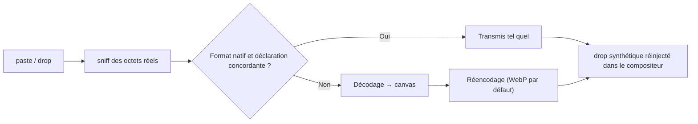

# dsh-paste-image

[](https://github.com/pengtang1024/dsh-paste-image/actions/workflows/ci.yml)
[](LICENSE)
[](https://www.npmjs.com/package/dsh-paste-image)
[](package.json)
[](CHANGELOG.md)

[简体中文](docs/DETAIL.zh.md) · [English](docs/DETAIL.en.md) · [Español](docs/DETAIL.es.md) · [Français](docs/DETAIL.fr.md) · [Deutsch](docs/DETAIL.de.md) · [Русский](docs/DETAIL.ru.md) · [Português](docs/DETAIL.pt.md)

Collez ou déposez presque n'importe quelle image dans DeepSeek Harness — même quand le presse-papiers annonce `image/xpm` ou ment sur le type MIME.

| Version actuelle | Sortie par défaut | Dépendance d'exécution | Prérequis Node |
| ---------------- | ----------------- | ---------------------- | -------------- |
| 0.6.1            | WebP              | Aucune                 | ≥ 20           |

> 📌 **En bref :** les octets priment sur l'étiquette — détecter le format réel, transcoder dans le processus de rendu vers un format autorisé (WebP par défaut), puis renvoyer le résultat au canal de pièces jointes natif.

## Navigation rapide

| Objectif                | Où aller                                                                                                                                        |
| ----------------------- | ----------------------------------------------------------------------------------------------------------------------------------------------- |
| Comprendre le problème  | [Pourquoi ce plugin existe](#pourquoi-ce-plugin-existe) · [Fonctionnement](#fonctionnement) · [Formats pris en charge](#formats-pris-en-charge) |
| Installer et utiliser   | [Installation](#installation) · [Vérifier que ça fonctionne](#vérifier-que-ça-fonctionne) · [Configuration](#configuration)                     |
| Approfondir les détails | [Limites](#limites) · [Performance](#performance) · [Compatibilité](#compatibilité) · [Fonctionnement détaillé](docs/en/how-it-works.md)        |
| Dépanner et contribuer  | [Sécurité et confidentialité](#sécurité-et-confidentialité) · [Dépannage](docs/en/troubleshooting.md) · [Contribuer](CONTRIBUTING.en.md)        |

## Pourquoi ce plugin existe

Le client de bureau DSH (Electron/Chromium) n'accepte que quatre types de pièces jointes : `image/png`, `image/jpeg`, `image/webp` et `image/gif`. Tout le reste est rejeté par une erreur rouge :

> ⚠️ **Message de l'hôte :** seuls PNG, JPG, WebP et GIF sont pris en charge

Cette liste blanche casse deux situations très courantes sous Linux :

- **Des captures d'écran déclarées en XPM.** Certains outils de capture, notamment sous Ubuntu/Wayland, placent l'image dans le presse-papiers avec le type `image/xpm`. Les pixels sont corrects ; c'est l'étiquette qui n'est pas dans la liste blanche, et le collage est rejeté.
- **Des octets BMP déguisés en PNG.** Certaines applications fournissent un contenu BMP (ou TIFF) tout en déclarant `image/png`. Le type déclaré passe le contrôle de la liste blanche, le décodeur échoue ensuite, et vous obtenez la même erreur rouge.

`dsh-paste-image` traite les deux cas dans le processus de rendu : il examine les octets réels, décode ce que le presse-papiers contient vraiment, le réencode dans le format de sortie choisi (WebP par défaut), puis renvoie le résultat au canal de pièces jointes habituel.

## Fonctionnement



1. **Capture.** `install()` enregistre des écouteurs `paste` et `drop` sur `document` en phase de capture, de sorte que le plugin voie l'événement avant la zone de saisie.
2. **Identification.** `handle()` lit les objets `File` depuis `clipboardData` ou `dataTransfer`, et `sniff()` identifie le format réel à partir des octets magiques — pas à partir du type MIME déclaré.
3. **Réencodage.** `normalize()` laisse passer tels quels les fichiers natifs. Tout le reste est décodé (chemins dédiés pour XPM, BMP/DIB et SVG, codec du navigateur pour le reste), dessiné sur un canvas limité à 4096 px sur le côté le plus long, puis exporté dans le format de sortie choisi (WebP par défaut) ; l'extension suit le MIME réel (`.png`/`.jpg`/`.webp`).
4. **Réaiguillage.** `handle()` émet un événement `drop` synthétique transportant le nouveau `File` sur `[data-composer-card]`, soit le même chemin qu'un véritable glisser-déposer. Un marqueur `__dshPasteImageRerouted` empêche le plugin d'intercepter son propre événement.

Tout cela se passe côté client. Il n'y a ni processus hôte, ni interrogation du presse-papiers, ni requête réseau.

## Formats pris en charge

Ce tableau est la version courte. La [référence des formats pris en charge](docs/en/formats.md) détaille le pipeline de décision, la grille complète des variantes BMP et ce qui est volontairement hors périmètre.

| Format                        | Type déclaré courant | Ce qui se passe                                                                                                                                                       |
| ----------------------------- | -------------------- | --------------------------------------------------------------------------------------------------------------------------------------------------------------------- |
| PNG                           | `image/png`          | Transmis sans modification                                                                                                                                            |
| JPEG / JFIF                   | `image/jpeg`         | Transmis sans modification                                                                                                                                            |
| WebP                          | `image/webp`         | Transmis sans modification                                                                                                                                            |
| GIF                           | `image/gif`          | Transmis sans modification                                                                                                                                            |
| XPM (texte XPM3)              | `image/xpm`          | Décodé par `decodeXpm()`, réencodé dans le format de sortie choisi (WebP par défaut)                                                                                  |
| BMP / DIB                     | `image/bmp`          | Décodage par le navigateur d'abord, repli sur `decodeBmp()` : 1/4/8/16/24/32 bits, RLE4/RLE8, BITFIELDS, en-têtes OS/2 et DIB sans en-tête                            |
| SVG                           | `image/svg+xml`      | Rasterisé via un élément ``, réencodé dans le format de sortie choisi (WebP par défaut)                                                                          |
| ICO / CUR                     | `image/x-icon`       | Décodage par le navigateur d'abord, puis repli sur la plus grande entrée compressée en PNG                                                                            |
| TIFF                          | `image/tiff`         | Détecté par ses octets magiques ; décodé uniquement si le navigateur embarque un codec TIFF (ce n'est pas le cas de Chromium), sinon l'original est transmis tel quel |
| AVIF                          | `image/avif`         | Décodé par Chromium, réencodé dans le format de sortie choisi (WebP par défaut)                                                                                       |
| HEIC / HEIF, autres `image/*` | `image/...`          | Détecté par ses octets magiques ; décodé uniquement si le navigateur dispose du codec (Chromium ne décode pas HEIC), sinon transmis tel quel                          |

Le passage direct n'a lieu que si les octets magiques correspondent à l'un des quatre types natifs **et** que le type déclaré concorde. Un fichier dont les octets sont du JPEG mais qui se déclare `image/png` est réencodé dans le format de sortie choisi (WebP par défaut) : le type déclaré ne peut plus mentir. Un fichier natif sans aucun type déclaré est réenveloppé avec le type détecté au lieu d'être réencodé, et les graphies alias courantes (`image/jpg`, `image/x-png`, `image/x-bmp`, `image/x-xpixmap`, `image/svg+xml`, …) valent concordance.

Un fichier n'est pris en compte que si son type MIME commence par `image/` ou si son nom se termine par `.png`, `.jpg`, `.jpeg`, `.jfif`, `.gif`, `.webp`, `.bmp`, `.dib`, `.tif`, `.tiff`, `.xpm`, `.avif`, `.ico`, `.cur`, `.svg`, `.heic` ou `.heif`. Les fichiers non-image d'un même collage sont transmis tels quels.

## Installation

```bash
dsh plugin --profile <profile> add dsh-paste-image
```

Le paquet est livré déjà compilé — bundle du processus de rendu, entrée hôte, patch du loader, métadonnées d'affichage et documentation multilingue — l'installation le récupère donc directement depuis le registre npm. On peut aussi l'installer depuis GitHub en contournant le registre :

```bash
dsh plugin --profile <profile> add github:pengtang1024/dsh-paste-image
```

Pour le développement local, pointez le profil vers votre copie du dépôt :

```bash
dsh plugin --profile <profile> add file:/absolute/path/to/dsh-paste-image
```

Remplacez `<profile>` par le profil utilisé par votre application.

> 🔄 **Rechargez la page après l'installation** (`Ctrl+R`, ou `Cmd+R` sous macOS) : le module client n'est injecté qu'au chargement du processus de rendu ; sans rechargement, le plugin n'intercepte rien.

**Prérequis hôte :** DSH doit satisfaire la plage `engines.dsh` déclarée dans le paquet (les versions 0.2.x à partir de 0.2.0-rc.2, avant 0.4.0) et Node >= 20 ; la compatibilité version par version figure dans `dsh.compatibility.dshReleases`. Si la version de DSH ne convient pas, le plugin n'est pas chargé et la page de détail l'indique.

## Vérifier que ça fonctionne

Lancez d'abord les vérifications du dépôt :

```bash
cd dsh-paste-image
npm test
npm run check
```

`npm test` exécute la suite de tests Node : détection par octets magiques, détection des candidats, toutes les variantes BMP, la conversion d'un BMP étiqueté PNG, les DIB sans en-tête, le passage direct des fichiers natifs, la page de configuration et ses réglages d'exécution, ainsi que les métadonnées d'affichage fournies pour chaque langue. `npm run check` vérifie la syntaxe de `client.js` et de `lib/index.js`.

Vérifiez ensuite le flux réel :

1. Rechargez la fenêtre DSH.
2. Faites une capture d'écran avec votre outil habituel et collez-la dans la zone de saisie, ou déposez-y un fichier image.
3. La pièce jointe apparaît. Ouvrez les DevTools (`Ctrl+Shift+I`) → Console, passez le niveau sur **Verbose**, et cherchez une ligne du type :

```text
[dsh-paste-image] image/xpm -> image/png 1440x900
```

Si la conversion échoue, le plugin conserve le fichier d'origine et journalise `keep original (...)` à la place.

## Configuration

Les réglages du plugin se trouvent désormais sous **Paramètres → Coller n'importe quelle image**, ce qui ouvre directement le formulaire complet. L'ancienne entrée via la ligne du plugin reste disponible : **Paramètres → Extensions → dsh-paste-image → Configuration** ; la ligne du plugin affiche en outre un résumé d'une ligne (activé / désactivé) qui mène au même formulaire. Les deux entrées partagent les mêmes réglages : une seule modification suffit. Les valeurs par défaut correspondent au comportement antérieur à l'introduction de cette page :

| Champ                       | Valeur par défaut | Plage / comportement                                                                                                                   |
| --------------------------- | ----------------- | -------------------------------------------------------------------------------------------------------------------------------------- |
| Activer le plugin           | Activé            | Désactivé, `handle()` retourne immédiatement et le collage/dépôt est entièrement natif (les écouteurs restent, réactivation immédiate) |
| Nombre max. de fichiers     | 8                 | 1–8 ; un lot plus important est entièrement confié à la voie native                                                                    |
| Limite du grand côté (px)   | 4096              | 512–8192 ; ne concerne que les images converties, les fichiers natifs ne sont pas redimensionnés                                       |
| Format de sortie            | WebP              | PNG / JPEG / WebP ; encodage des images converties                                                                                     |
| Qualité                     | 0.92              | 0.1–1, JPEG / WebP uniquement ; le champ est désactivé quand PNG est sélectionné                                                       |
| Convertir XPM               | Activé            | Désactivé, `image/xpm` n'est pas converti et part tel quel vers la voie native                                                         |
| Convertir BMP / DIB         | Activé            | Désactivé, BMP/DIB (y compris les fichiers dont les octets sont du BMP mais qui déclarent PNG) passent tels quels                      |
| Convertir SVG               | Activé            | Désactivé, le SVG n'est pas rastérisé et part tel quel vers la voie native                                                             |
| Convertir ICO / CUR         | Activé            | Désactivé, les icônes ne sont pas converties et partent telles quelles vers la voie native                                             |
| Journaliser les conversions | Activé            | Désactivé, les lignes `console.debug` `[dsh-paste-image] ...` ne sont plus affichées                                                   |

> 💡 **Prise d'effet :** seul un clic sur **Enregistrer** écrit les valeurs et les applique immédiatement ; les modifications du formulaire ne sont que des brouillons dans la page et sont perdues quand vous la quittez. **Restaurer les valeurs par défaut** réécrit toutes les valeurs du tableau et les applique tout aussi immédiatement. Les champs numériques sont arrondis et ramenés dans leur plage (vider un champ n'écrase pas la valeur enregistrée avec 0).

WebP est la sortie par défaut : il conserve la transparence tout en restant léger ; PNG est sans perte ; JPEG produit des fichiers plus petits, mais compose les pixels transparents sur un fond blanc avant l'encodage. Quand le navigateur ne sait pas encoder le format choisi, le plugin retombe sur le type réellement produit, puis sur PNG s'il ne le reconnaît pas — dans le tableau des formats ci-dessus, sans changement de format, les images converties restent en WebP par défaut.

L'économie réelle dépend du contenu de l'image (q=0.92, tailles en Ko, 1 Ko = 1000 octets) :

| Contenu             | Dimensions | PNG    | JPEG                           | WebP  |
| ------------------- | ---------- | ------ | ------------------------------ | ----- |
| Capture d'interface | 1440×900   | 69.7   | 103.6                          | 33.9  |
| Photo               | 1600×1200  | 3535.3 | 649.3                          | 628.0 |
| Logo transparent    | 512×512    | 349.1  | 25.8 (fond blanc, alpha perdu) | 56.6  |
| Pixel art           | 256×256    | 4.1    | 2.9                            | 2.9   |

Les photos sont environ 82 % plus petites en JPEG/WebP, tandis que les captures d'interface et le pixel art sont souvent plus petits en PNG ; n'utilisez pas JPEG pour une image transparente. Environnement, méthode, durées et comparaison à q=0.8 figurent dans les [mesures complètes](docs/en/output-formats.md).

Les réglages ne sont conservés que dans le `localStorage` du navigateur courant, sous la clé `dsh-paste-image.settings.v1` : rien n'est téléversé, rien n'est écrit dans l'hôte, et aucune synchronisation entre navigateurs ou profils. En mode privé ou si `localStorage` est indisponible, ils retombent en mémoire et reviennent aux valeurs par défaut après rechargement. Aucun rechargement n'est nécessaire après enregistrement : le collage suivant utilise les nouveaux réglages.

## Limites

- **XPM :** format texte XPM3 uniquement. Le parseur lit la clé de couleur `c` ; les autres clés comme `m`, `g` et `s` sont ignorées. Les couleurs sont résolues par le parseur CSS du navigateur : les noms de palette qui ne sont pas des couleurs CSS valides, comme le `light gray` en deux mots, retombent sur du noir opaque.
- **BMP :** 1/4/8/16/24/32 bits, `BI_RGB`, `BI_RLE8`, `BI_RLE4`, `BI_BITFIELDS` et `BI_ALPHABITFIELDS`, avec en-têtes core, extended, V4/V5 ou OS/2 — plus les DIB sans en-tête. Les variantes 2 bits et 64 bits par pixel ne sont pas prises en charge. Pour les fichiers 32 bits sans masque alpha déclaré, un canal alpha entièrement nul est traité comme opaque au lieu de produire un PNG totalement transparent.
- **Autres codecs :** le SVG est rastérisé en interne ; ICO/CUR retombent sur les entrées compressées en PNG ; AVIF s'appuie sur le décodeur du navigateur. TIFF et HEIC sont détectés, mais Chromium n'embarque aucun codec pour eux : l'original est transmis tel quel et l'hôte le rejette comme avant. Aucun décodeur tiers n'est embarqué.
- **Taille :** les images converties sont réduites par défaut à 4096 px au maximum sur le côté le plus long ; ajustable dans la [configuration](#configuration). Les fichiers natifs transmis tels quels ne sont pas redimensionnés.
- **Nombre de fichiers :** un collage ou un dépôt peut contenir au plus 8 fichiers par défaut ; ajustable dans la [configuration](#configuration). Les lots plus importants sont entièrement laissés au chemin natif.
- **Aplatissement :** une image convertie devient une seule image fixe (WebP par défaut). L'animation, les métadonnées EXIF et les profils de couleur intégrés ne sont pas conservés.
- **Périmètre :** seuls les chemins `paste` et `drop` sont couverts. Le sélecteur de fichiers et les autres chemins d'insertion conservent leur comportement natif.

## Performance

La version 0.3.1 a optimisé les chemins critiques ; les chiffres proviennent de `bench/bench.mjs`, sur la même machine, sous Node 24 :

| Cas                                    | 0.3.0                                                   | 0.3.1                                                   |
| -------------------------------------- | ------------------------------------------------------- | ------------------------------------------------------- |
| Passage direct d'un PNG natif (20 MiB) | 3.803–3.929 ms/op ; 20,971,520 octets lus intégralement | 0.0038–0.0063 ms/op ; 0 octet lu intégralement          |
| Décodage XPM (512×512, 64 couleurs)    | 4.712–4.837 ms/op                                       | 3.35–3.95 ms/op (≈ −24 %, plage observée −18 % à −29 %) |
| Conversion BMP→PNG (1024×1024)         | ≈ 3.9–4.0 ms/op                                         | ≈ 3.9–4.0 ms/op, inchangée                              |
| `decodeBmp` (24/32 bits, RLE8)         | —                                                       | inchangé dans le bruit de mesure                        |

`normalize()` lit désormais au plus un en-tête de 1 Kio via `file.slice()` pour détecter le type ; dès que le type détecté est natif (PNG/JPEG/WebP/GIF) et que le MIME déclaré concorde, il retourne sans jamais charger le fichier entier en mémoire. Il ne retombe sur une lecture complète de `arrayBuffer()` que lorsque les octets doivent être retypés (déclaration vide) ou réellement convertis. `resolveColor()` réutilise un canvas 1×1, et XPM utilise une table de codes de caractères au lieu d'un `row.slice()` par pixel quand le code ne fait qu'un caractère. Le décodeur BMP et le chemin de conversion n'ont pas changé.

L'optimisation reste dans ce code synchrone du processus de rendu : aucun nouveau worker, aucune requête réseau, aucun changement de moment d'intervention du plugin. Reproduisez les mesures avec `npm run bench` (ou `npm run bench -- --quick`) ; les chiffres enregistrés dans le dépôt sont des valeurs de référence, pas des seuils CI.

## Compatibilité

Le plugin vise les API du processus de rendu fournies par les navigateurs Chromium/Electron modernes : `File`/`Blob`, `TextDecoder`, `createImageBitmap`, `canvas.toBlob`, `DataTransfer`/`DragEvent`, et `addEventListener` avec un `signal`. Sur cette base, quatre capacités absentes font l'objet d'un repli explicite, pour qu'une API manquante ne désactive pas le plugin ni n'absorbe un événement natif :

| Capacité manquante           | Comportement de repli                                                                                                                       |
| ---------------------------- | ------------------------------------------------------------------------------------------------------------------------------------------- |
| `AbortController`            | `install()` enregistre les écouteurs sans `signal` ; le disposer les retire précisément avec `removeEventListener`                          |
| `canvas.toBlob`              | `encodeCanvas()` retombe sur `toDataURL()`, puis décode le base64 en `Blob`                                                                 |
| `DataTransfer` / `DragEvent` | `handle()` retourne avant de réclamer l'événement ou d'appeler `preventDefault()` ; la voie native du navigateur reste intacte              |
| `[data-composer-card]`       | `handle()` retourne dès que la cible est absente : il ne réclame rien, n'appelle pas `preventDefault()`, et le collage natif reste inchangé |

Les objets de type `File` dépourvus de `slice()`/`size` ne peuvent pas lire seulement l'en-tête et retombent sur la lecture intégrale d'origine. La CI exécute la suite complète sur Node 20, 22 et 24, avec en plus un job de fumée `bench/bench.mjs --quick` ; on compte actuellement 102 tests couvrant les DIB sans en-tête, les BMP 1/4/8/16/24/32 bits, RLE4/RLE8, BITFIELDS, les en-têtes OS/2 core, la détection TIFF/HEIC/AVIF, les alias MIME, le BMP déguisé en PNG, la limite de 8 fichiers, la transmission des fichiers non-image, les quatre replis ci-dessus, ainsi que le contrat d'enregistrement et le comportement de la page de configuration. Les différences de plateforme par format et les dépendances aux codecs du navigateur figurent dans la [prise en charge des formats](docs/en/formats.md).

## Sécurité et confidentialité

- Tout s'exécute dans le processus de rendu. Le plugin n'émet aucune requête réseau, ne téléverse rien et ne stocke rien.
- Aucun processus en arrière-plan, aucune interrogation du presse-papiers, aucune modification du code hôte de DSH.
- Les octets de l'image sont lus uniquement depuis l'événement de collage ou de dépôt, décodés localement, puis renvoyés à la même fenêtre.
- Les décodeurs sont compacts, mais ils traitent bel et bien des entrées non fiables. Si vous rencontrez un plantage ou un bug d'analyse, consultez [SECURITY.md](SECURITY.en.md).

## Langues

Le plugin fournit des métadonnées d'affichage pour chaque langue prise en charge par l'interface DSH — chinois simplifié, anglais, espagnol, français, allemand, russe et portugais. Chaque fichier `locale/<language>.json` porte le titre et la description localisés, et fait pointer sa page de détail vers le README correspondant de ce dépôt, afin que le Plugin Manager et sa page de détail parlent la même langue que l'application.

**Le chinois simplifié est la langue source.** `README.md`, les pages sous `docs/`ainsi que `CONTRIBUTING.md`, `CHANGELOG.md` et `SECURITY.md` sont rédigés en chinois ; les autres langues sont des traductions qui les suivent, l'anglais correspondant à `README.en.md` et `docs/en/`. Les traductions sont des fichiers source à côté du code, pas du texte généré. La suite de tests vérifie que chaque langue annoncée dispose d'un fichier de locale, d'un document de détail et de liens vers les autres README. Pour corriger ou ajouter une traduction, voir [Contribuer](CONTRIBUTING.en.md#translations).

## Documentation

- [Fonctionnement détaillé](docs/en/how-it-works.md) — flux d'événements, internes des décodeurs et carte du code fonction par fonction.
- [Prise en charge des formats](docs/en/formats.md) — pipeline de décision, matrice des formats, variantes BMP et liste de contrôle pour ajouter un format.
- [Mesures des formats de sortie](docs/en/output-formats.md) — tailles et durées d'encodage PNG / JPEG / WebP, par type de contenu.
- [Dépannage](docs/en/troubleshooting.md) — échecs courants et comment lire les journaux.
- [Publication](docs/en/releasing.md) — politique de version et liste de contrôle de publication pour les mainteneurs.

## Communauté

- [Contribuer](CONTRIBUTING.en.md) — installation, tests, style, traductions et ce qu'exige une contribution de format.
- [Code de conduite](CODE_OF_CONDUCT.md) — Contributor Covenant 2.1.
- [Politique de sécurité](SECURITY.en.md) — signalement privé, périmètre et versions prises en charge.
- [Changelog](CHANGELOG.en.md) et [releases](https://github.com/pengtang1024/dsh-paste-image/releases) — ce qui a changé et pourquoi.
- [Issues](https://github.com/pengtang1024/dsh-paste-image/issues) — rapports de bugs et demandes de formats.

## Licence

MIT © 2026 pengtang1024. Voir [LICENSE](LICENSE).

## Soutenez ce projet

Si ce plugin vous est utile au quotidien, n'hésitez pas à mettre une étoile ⭐ à [dsh-paste-image](https://github.com/pengtang1024/dsh-paste-image). Ce petit geste m'encourage à continuer à le maintenir.
