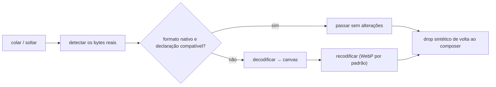

# dsh-paste-image

[](https://github.com/pengtang1024/dsh-paste-image/actions/workflows/ci.yml)
[](LICENSE)
[](https://www.npmjs.com/package/dsh-paste-image)
[](package.json)
[](CHANGELOG.md)

[简体中文](docs/DETAIL.zh.md) · [English](docs/DETAIL.en.md) · [Español](docs/DETAIL.es.md) · [Français](docs/DETAIL.fr.md) · [Deutsch](docs/DETAIL.de.md) · [Русский](docs/DETAIL.ru.md) · [Português](docs/DETAIL.pt.md)

Cole ou arraste quase qualquer imagem para o DeepSeek Harness — mesmo quando a área de transferência diz `image/xpm` ou mente sobre o tipo MIME.

| Versão atual | Saída padrão | Dependências em runtime | Requisito do Node |
| ------------ | ------------ | ----------------------- | ----------------- |
| 0.6.1        | WebP         | nenhuma                 | >= 20             |

> 📌 **Em uma frase:** os bytes valem mais que o rótulo — detecte o formato real, recodifique no renderer para um formato da lista de permissões (WebP por padrão) e devolva ao canal normal de anexos.

## Navegação rápida

| O que você quer fazer             | Onde ir                                                                                                                                    |
| --------------------------------- | ------------------------------------------------------------------------------------------------------------------------------------------ |
| Entender o problema               | [Por que este plugin existe](#por-que-este-plugin-existe) · [Como funciona](#como-funciona) · [Formatos suportados](#formatos-suportados)  |
| Instalar e usar                   | [Instalação](#instalação) · [Verifique se funciona](#verifique-se-funciona) · [Configurações](#configurações)                              |
| Aprofundar detalhes técnicos      | [Limitações](#limitações) · [Desempenho](#desempenho) · [Compatibilidade](#compatibilidade) · [Como funciona](docs/how-it-works.md)        |
| Solucionar problemas e contribuir | [Segurança e privacidade](#segurança-e-privacidade) · [Solução de problemas](docs/troubleshooting.md) · [Como contribuir](CONTRIBUTING.md) |

## Por que este plugin existe

O cliente desktop do DSH (Electron/Chromium) aceita exatamente quatro tipos de anexo: `image/png`, `image/jpeg`, `image/webp` e `image/gif`. Qualquer outro é rejeitado com um erro em vermelho:

> ⚠️ **Aviso do host:** apenas PNG, JPG, WebP e GIF são suportados

Essa lista branca quebra duas coisas que acontecem o tempo todo no Linux:

- **Capturas de tela declaradas como XPM.** Algumas ferramentas de captura de tela, principalmente no Ubuntu/Wayland, colocam a imagem na área de transferência com o tipo `image/xpm`. Os pixels estão corretos; o rótulo é que não está na lista branca, então a colagem é rejeitada.
- **Bytes BMP vestindo rótulo de PNG.** Alguns aplicativos entregam um payload BMP (ou TIFF) declarando `image/png`. O tipo declarado passa na verificação da lista branca, o decodificador falha depois, e você recebe o mesmo erro em vermelho.

O `dsh-paste-image` resolve os dois casos dentro do renderer: ele olha os bytes reais, decodifica o que a área de transferência realmente contém, recodifica no formato de saída escolhido (WebP por padrão) e devolve o resultado ao canal normal de anexos.

## Como funciona



1. **Captura.** `install()` registra listeners de `paste` e `drop` em `document` na fase de captura, para que o plugin veja o evento antes do composer.
2. **Detecção.** `handle()` lê os objetos `File` de `clipboardData` ou `dataTransfer`, e `sniff()` identifica o formato real pelos magic bytes — não pelo tipo MIME declarado.
3. **Recodificação.** `normalize()` deixa os quatro formatos nativos passarem intactos. Todo o resto é decodificado (caminhos dedicados para XPM, BMP/DIB e SVG, o codec do próprio navegador para o restante), desenhado em um canvas limitado a 4096 px no lado mais longo e exportado no formato de saída escolhido (WebP por padrão); a extensão segue o MIME real (`.png`/`.jpg`/`.webp`).
4. **Redirecionamento.** `handle()` dispara um evento `drop` sintético carregando o novo `File` em `[data-composer-card]`, que é o mesmo caminho percorrido por um arrastar-e-soltar real. Um marcador `__dshPasteImageRerouted` impede que o plugin intercepte o próprio evento.

Tudo isso roda no cliente. Não existe processo host, não há polling da área de transferência e nenhuma requisição de rede é feita.

## Formatos suportados

Esta tabela é a versão curta. A [referência de suporte a formatos](docs/formats.md) explica o pipeline de decisão, a grade completa de variantes de BMP e o que está intencionalmente fora de escopo.

| Formato                       | Tipo declarado típico | O que acontece                                                                                                                                     |
| ----------------------------- | --------------------- | -------------------------------------------------------------------------------------------------------------------------------------------------- |
| PNG                           | `image/png`           | Passa intacto, sem alterações                                                                                                                      |
| JPEG / JFIF                   | `image/jpeg`          | Passa intacto, sem alterações                                                                                                                      |
| WebP                          | `image/webp`          | Passa intacto, sem alterações                                                                                                                      |
| GIF                           | `image/gif`           | Passa intacto, sem alterações                                                                                                                      |
| XPM (texto XPM3)              | `image/xpm`           | Decodificado por `decodeXpm()`, recodificado no formato de saída escolhido (WebP por padrão)                                                       |
| BMP / DIB                     | `image/bmp`           | Decodificação pelo navegador primeiro, fallback em `decodeBmp()`: 1/4/8/16/24/32 bits, RLE4/RLE8, BITFIELDS, cabeçalhos OS/2 e DIBs sem cabeçalho  |
| SVG                           | `image/svg+xml`       | Rasterizado por meio de um elemento ``, recodificado no formato de saída escolhido (WebP por padrão)                                          |
| ICO / CUR                     | `image/x-icon`        | Decodificação pelo navegador primeiro, depois fallback para a maior entrada comprimida em PNG                                                      |
| TIFF                          | `image/tiff`          | Detectado pelos magic bytes; decodificado apenas se o navegador tiver um codec TIFF (o Chromium não tem); caso contrário, o original passa intacto |
| AVIF                          | `image/avif`          | Decodificado pelo Chromium, recodificado no formato de saída escolhido (WebP por padrão)                                                           |
| HEIC / HEIF, outros `image/*` | `image/...`           | Detectado pelos magic bytes; decodificado apenas quando o navegador tem o codec (o Chromium não decodifica HEIC); caso contrário, passa intacto    |

O repasse intacto só acontece quando os magic bytes correspondem a um dos quatro tipos nativos **e** o tipo declarado concorda. Um arquivo cujos bytes são JPEG mas que declara `image/png` é recodificado no formato de saída escolhido (WebP por padrão), então o tipo declarado não consegue mais mentir. Um arquivo nativo sem nenhum tipo declarado é reembrulhado com o tipo detectado em vez de ser recodificado, e grafias alternativas comuns (`image/jpg`, `image/x-png`, `image/x-bmp`, `image/x-xpixmap`, `image/svg+xml`, …) contam como concordância.

Um arquivo é considerado quando seu tipo MIME começa com `image/` ou seu nome termina em `.png`, `.jpg`, `.jpeg`, `.jfif`, `.gif`, `.webp`, `.bmp`, `.dib`, `.tif`, `.tiff`, `.xpm`, `.avif`, `.ico`, `.cur`, `.svg`, `.heic` ou `.heif`. Arquivos que não são imagem na mesma colagem são encaminhados intactos.

## Instalação

```bash
dsh plugin --profile <profile> add dsh-paste-image
```

O pacote é distribuído pré-compilado — bundle do renderer, entrada do host, patch do loader, metadados de exibição e documentação multilíngue — então a instalação o baixa direto do registry do npm. Também é possível instalar direto do GitHub, sem passar pelo registry:

```bash
dsh plugin --profile <profile> add github:pengtang1024/dsh-paste-image
```

Para desenvolvimento local, aponte o profile para o seu checkout:

```bash
dsh plugin --profile <profile> add file:/absolute/path/to/dsh-paste-image
```

Substitua `<profile>` pelo profile em que o seu app roda.

> 🔄 **Recarregue a página depois de instalar** (`Ctrl+R`, ou `Cmd+R` no macOS): o módulo do cliente só é injetado quando o renderer carrega, então um plugin recém-instalado não intercepta nada até você recarregar.

**Requisitos do host:** o DSH precisa satisfazer o intervalo `engines.dsh` declarado no pacote (cobre as versões 0.2.x a partir da 0.2.0-rc.2, até antes da 0.4.0), e Node >= 20; a compatibilidade por versão está em `dsh.compatibility.dshReleases` no pacote. Em uma versão não suportada do DSH, o plugin não é carregado e a página de detalhes exibe o aviso correspondente.

## Verifique se funciona

Rode as verificações do repositório:

```bash
cd dsh-paste-image
npm test
npm run check
```

`npm test` roda a suíte de testes Node: detecção por magic bytes, identificação de candidatos, cada variante de BMP, a conversão de PNG rotulado como BMP, DIBs sem cabeçalho, o repasse intacto de nativos, a página de configurações e suas configurações em runtime, além dos metadados de exibição distribuídos para cada idioma. `npm run check` faz a verificação de sintaxe de `client.js` e `lib/index.js`.

Depois confira o fluxo real:

1. Recarregue a janela do DSH.
2. Tire uma captura de tela com a sua ferramenta de costume e cole no composer, ou arraste um arquivo de imagem para dentro dele.
3. O anexo aparece. Abra o DevTools (`Ctrl+Shift+I`) → Console, mude o nível para **Verbose** e procure uma linha como:

```text
[dsh-paste-image] image/xpm -> image/png 1440x900
```

Se a conversão falhar, o plugin mantém o arquivo original e registra `keep original (...)`.

## Configurações

As configurações do plugin agora ficam em **Configurações → Colar qualquer imagem**, que abre diretamente o formulário completo. A entrada anterior pela linha do plugin continua disponível: **Configurações → Extensões → dsh-paste-image → Configurar**; a linha do plugin também mostra um resumo de uma linha (ativado / desativado) que leva ao mesmo formulário. Ambas as entradas compartilham as mesmas configurações, então basta alterar uma. Os valores padrão reproduzem o comportamento anterior à criação da página de configurações:

| Campo                        | Padrão | Faixa / comportamento                                                                                                         |
| ---------------------------- | ------ | ----------------------------------------------------------------------------------------------------------------------------- |
| Ativar plugin                | Sim    | Desligado, `handle()` retorna imediatamente e paste/drop seguem totalmente nativos (ouvintes permanecem; reativar é imediato) |
| Máx. de arquivos por colagem | 8      | 1–8; um lote maior é entregue inteiro ao caminho nativo                                                                       |
| Limite do lado maior (px)    | 4096   | 512–8192; vale apenas para imagens convertidas, o repasse nativo não é redimensionado                                         |
| Formato de saída             | WebP   | PNG / JPEG / WebP; a codificação usada na saída convertida                                                                    |
| Qualidade                    | 0.92   | 0.1–1, vale apenas para JPEG / WebP; o campo é desativado com PNG selecionado                                                 |
| Converter XPM                | Sim    | Desligado, `image/xpm` não é convertido e vai intacto ao canal nativo                                                         |
| Converter BMP / DIB          | Sim    | Desligado, BMP/DIB (inclusive bytes BMP declarados como PNG) passam intactos                                                  |
| Converter SVG                | Sim    | Desligado, SVG não é rasterizado e vai intacto ao canal nativo                                                                |
| Converter ICO / CUR          | Sim    | Desligado, ícones não são convertidos e vão intactos ao canal nativo                                                          |
| Registrar conversões         | Sim    | Desligado, as linhas `console.debug` `[dsh-paste-image] ...` não são impressas                                                |

> 💡 **Como aplicar:** só o **Salvar** grava e aplica os valores; as alterações no formulário são um rascunho na página e são descartadas ao sair dela. **Restaurar padrões** regrava todos os valores da tabela e também os aplica imediatamente. Campos numéricos são arredondados e limitados à faixa (limpar um campo não sobrescreve o valor salvo com 0).

WebP é a saída padrão: preserva a transparência e mantém o tamanho pequeno. PNG é sem perdas; JPEG gera arquivos menores, mas compõe pixels transparentes sobre branco antes de codificar. Quando o navegador não consegue codificar o formato escolhido, o plugin usa o tipo que realmente produziu e, se ele não for reconhecido, volta para PNG — a tabela de formatos acima continua descrevendo a saída WebP padrão, a menos que você troque de formato.

O quanto você realmente economiza depende do conteúdo da imagem (q=0.92, tamanhos em KB, 1 KB = 1000 B):

| Conteúdo          | Dimensões | PNG    | JPEG                               | WebP  |
| ----------------- | --------- | ------ | ---------------------------------- | ----- |
| Captura de UI     | 1440×900  | 69.7   | 103.6                              | 33.9  |
| Foto              | 1600×1200 | 3535.3 | 649.3                              | 628.0 |
| Logo transparente | 512×512   | 349.1  | 25.8 (fundo branco, alpha perdido) | 56.6  |
| Pixel art         | 256×256   | 4.1    | 2.9                                | 2.9   |

JPEG/WebP reduzem fotos em cerca de 82 %, enquanto capturas de interface e pixel art costumam ser menores em PNG; nunca escolha JPEG quando precisar de transparência. Ambiente, método, tempos e a comparação com q=0.8 estão nas [medições completas](docs/output-formats.md).

As configurações ficam apenas no `localStorage` deste navegador, sob a chave `dsh-paste-image.settings.v1`: nada é enviado, nada é gravado no host e nada é sincronizado entre navegadores ou profiles. No modo privado ou quando `localStorage` não está disponível, elas caem para a memória e voltam aos padrões após recarregar. Configurações salvas valem imediatamente — não é preciso recarregar, a próxima colagem já as usa.

## Limitações

- **XPM:** apenas o formato de texto XPM3. O parser lê a chave de cor `c`; outras chaves, como `m`, `g` e `s`, são ignoradas. As cores são resolvidas pelo parser CSS do navegador, então nomes de paleta que não são cores CSS válidas, como o `light gray` de duas palavras, caem para preto opaco.
- **BMP:** 1/4/8/16/24/32 bits, `BI_RGB`, `BI_RLE8`, `BI_RLE4`, `BI_BITFIELDS` e `BI_ALPHABITFIELDS`, com cabeçalhos core, estendido, V4/V5 ou OS/2 — além de DIBs sem cabeçalho. Variantes de 2 bits e de 64 bits por pixel não são suportadas. Para arquivos de 32 bits sem máscara alfa declarada, um canal alfa todo zerado é tratado como opaco em vez de produzir um PNG totalmente transparente.
- **Outros codecs:** SVG é rasterizado internamente; ICO/CUR recorrem a entradas comprimidas em PNG; AVIF depende do decodificador do navegador. TIFF e HEIC são detectados, mas o Chromium não traz codec para eles, então o original passa intacto e o host o rejeita como antes. Nenhum decodificador de terceiros está incluído.
- **Tamanho:** imagens convertidas são reduzidas, por padrão, a no máximo 4096 px no lado mais longo; ajuste em [Configurações](#configurações). Arquivos nativos que passam intactos não são redimensionados.
- **Quantidade de arquivos:** uma colagem ou soltura pode conter, por padrão, no máximo 8 arquivos; ajuste em [Configurações](#configurações). Lotes maiores são deixados inteiramente para o caminho nativo.
- **Achatamento:** uma imagem convertida vira um único quadro estático no formato de saída escolhido (WebP por padrão). Animação, metadados EXIF e perfis de cor embutidos não são preservados.
- **Escopo:** apenas os caminhos `paste` e `drop` são cobertos. O seletor de arquivos e outros caminhos de inserção mantêm o comportamento nativo.

## Desempenho

A versão 0.3.1 otimizou os caminhos críticos; os números vêm de `bench/bench.mjs`, na mesma máquina, com Node 24:

| Cenário                               | 0.3.0                                                  | 0.3.1                                                     |
| ------------------------------------- | ------------------------------------------------------ | --------------------------------------------------------- |
| Repasse de PNG nativo (20 MiB)        | 3.803–3.929 ms/op; 20.971.520 bytes lidos por completo | 0.0038–0.0063 ms/op; 0 bytes lidos por completo           |
| Decodificação XPM (512×512, 64 cores) | 4.712–4.837 ms/op                                      | 3.35–3.95 ms/op (cerca de -24 %, intervalo -18 % a -29 %) |
| Conversão BMP→PNG (1024×1024)         | ~3.9–4.0 ms/op                                         | ~3.9–4.0 ms/op, sem alteração                             |
| `decodeBmp` (24/32 bits, RLE8)        | —                                                      | inalterado dentro do ruído de execução                    |

`normalize()` agora lê, via `file.slice()`, no máximo um cabeçalho de 1 KiB para detectar o tipo; se o tipo detectado é nativo (PNG/JPEG/WebP/GIF) e o MIME declarado concorda, ele retorna sem jamais carregar o arquivo inteiro na memória. Só cai para uma leitura completa de `arrayBuffer()` quando os bytes precisam ser retipados (declaração vazia) ou de uma conversão real. `resolveColor()` reaproveita um canvas 1×1, e o XPM usa um mapa de códigos de caractere em vez de `row.slice()` por pixel quando o código é um único caractere. O decodificador BMP e o caminho de conversão não foram alterados.

A otimização fica apenas dentro do código síncrono do renderer: nenhum worker novo, nenhuma requisição de rede e nenhuma mudança no momento em que o plugin atua. Reproduza os números com `npm run bench` (ou `npm run bench -- --quick`); os valores registrados são referências, não limites de CI.

## Compatibilidade

O plugin mira as APIs de renderer que o Chromium/Electron moderno oferece: `File`/`Blob`, `TextDecoder`, `createImageBitmap`, `canvas.toBlob`, `DataTransfer`/`DragEvent` e `addEventListener` com `signal`. Sobre essa base, quatro ausências têm degradacão explícita, para que uma API faltando nunca desative o plugin por inteiro nem engula um evento nativo:

| Recurso ausente              | Comportamento de fallback                                                                                                               |
| ---------------------------- | --------------------------------------------------------------------------------------------------------------------------------------- |
| `AbortController`            | `install()` registra listeners sem `signal`, e o disposer os remove com `removeEventListener`                                           |
| `canvas.toBlob`              | `encodeCanvas()` cai para `toDataURL()` e depois decodifica o base64 em `Blob`                                                          |
| `DataTransfer` / `DragEvent` | `handle()` retorna antes de assumir o evento ou chamar `preventDefault()`, deixando o caminho nativo de paste/drop do navegador intacto |
| `[data-composer-card]`       | `handle()` retorna assim que o alvo falta: não assume, não chama `preventDefault()`, e o paste nativo continua como antes               |

Objetos parecidos com `File` sem `slice()`/`size` não conseguem ler só o cabeçalho e caem para o caminho original de leitura completa. A CI roda a suíte completa no Node 20, 22 e 24, além de um job de smoke com `bench/bench.mjs --quick`; a suíte tem atualmente 102 testes aprovados, cobrindo DIBs sem cabeçalho, BMP de 1/4/8/16/24/32 bits, RLE4/RLE8, BITFIELDS, cabeçalhos core do OS/2, detecção de TIFF/HEIC/AVIF, aliases de MIME, BMP declarado como PNG, o limite de 8 arquivos, o repasse de não-imagens, as quatro rotas de fallback acima, além do contrato de registro e do comportamento da página de configurações. Diferenças de plataforma por formato e dependências de codec do navegador estão em [suporte a formatos](docs/formats.md).

## Segurança e privacidade

- Tudo roda no renderer. O plugin não faz requisições de rede, não envia nada e não armazena nada.
- Não há processo em segundo plano, polling da área de transferência nem alteração no código do host do DSH.
- Os bytes da imagem são lidos apenas do evento de paste ou drop, decodificados localmente e devolvidos à mesma janela.
- Os decodificadores são pequenos, mas processam entrada não confiável. Se você encontrar um crash ou um bug de parsing, veja [SECURITY.md](SECURITY.md).

## Idiomas

O plugin distribui metadados de exibição para todos os idiomas que a interface do DSH suporta — as sete línguas chinês simplificado, inglês, espanhol, francês, alemão, russo e português (sem japonês). Cada `locale/<language>.json` traz o título e a descrição localizados e aponta sua página de detalhes para o README correspondente neste repositório, para que o Plugin Manager e sua página de detalhes falem o mesmo idioma do app.

**O chinês simplificado é o idioma-fonte.** Este README, as páginas em `docs/` e `CONTRIBUTING.md`, `CHANGELOG.md` e `SECURITY.md` são escritos em chinês; as demais línguas são traduções que acompanham a fonte, e a versão em inglês são `README.en.md` e `docs/en/`. As traduções são arquivos-fonte ao lado do código, não texto gerado em runtime. A suíte de testes verifica que todo idioma anunciado tem um arquivo de locale, um documento de detalhes e links para os outros READMEs. Para corrigir ou adicionar uma tradução, veja [Como contribuir](CONTRIBUTING.en.md#translations).

## Documentação

- [Como funciona](docs/how-it-works.md) — fluxo de eventos, interior dos decodificadores e um mapa do código função por função.
- [Suporte a formatos](docs/formats.md) — pipeline de decisão, matriz de formatos, variantes de BMP e o checklist para adicionar um formato.
- [Medições dos formatos de saída](docs/output-formats.md) — tamanhos de PNG / JPEG / WebP e tempos de codificação, por tipo de conteúdo.
- [Solução de problemas](docs/troubleshooting.md) — falhas comuns e como ler os logs.
- [Publicação](docs/releasing.md) — política de versões e o checklist de release do mantenedor.

## Comunidade

- [Como contribuir](CONTRIBUTING.md) — configuração do ambiente, testes, estilo, traduções e o que uma contribuição de formato exige.
- [Código de Conduta](CODE_OF_CONDUCT.md) — Contributor Covenant 2.1.
- [Política de segurança](SECURITY.md) — relato privado, escopo e versões suportadas.
- [Changelog](CHANGELOG.md) e [releases](https://github.com/pengtang1024/dsh-paste-image/releases) — o que mudou e por quê.
- [Issues](https://github.com/pengtang1024/dsh-paste-image/issues) — relatos de bugs e pedidos de formato.

## Licença

MIT © 2026 pengtang1024. Veja [LICENSE](LICENSE).

## Apoie este projeto

Se este plugin tem sido útil no seu dia a dia, dê uma estrela ⭐ ao [dsh-paste-image](https://github.com/pengtang1024/dsh-paste-image). Esse pequeno gesto me motiva muito a continuar mantendo-o.
