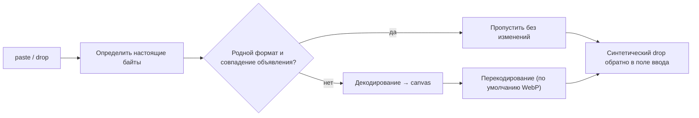

# dsh-paste-image

[](https://github.com/pengtang1024/dsh-paste-image/actions/workflows/ci.yml)
[](LICENSE)
[](https://www.npmjs.com/package/dsh-paste-image)
[](package.json)
[](CHANGELOG.md)

[简体中文](docs/DETAIL.zh.md) · [English](docs/DETAIL.en.md) · [Español](docs/DETAIL.es.md) · [Français](docs/DETAIL.fr.md) · [Deutsch](docs/DETAIL.de.md) · [Русский](docs/DETAIL.ru.md) · [Português](docs/DETAIL.pt.md)

Вставляйте или перетаскивайте в DeepSeek Harness почти любое изображение — даже когда буфер обмена сообщает `image/xpm` или лжёт о типе MIME.

| Текущая версия | Вывод по умолчанию | Зависимости во время выполнения | Требование к Node |
| -------------- | ------------------ | ------------------------------- | ----------------- |
| 0.6.1          | WebP               | Нет                             | ≥ 20              |

> 📌 **Коротко:** байты важнее меток — определить настоящий формат по сигнатуре, перекодировать в рендерере в формат из белого списка (по умолчанию WebP) и вернуть в родной канал вложений.

## Быстрая навигация

| Что вы хотите сделать                   | Куда идти                                                                                                                                                                   |
| --------------------------------------- | --------------------------------------------------------------------------------------------------------------------------------------------------------------------------- |
| Понять, какие задачи решает плагин      | [Зачем это нужно](#зачем-это-нужно) · [Как это работает](#как-это-работает) · [Поддерживаемые форматы](#поддерживаемые-форматы)                                             |
| Установить и начать пользоваться        | [Установка](#установка) · [Проверка работоспособности](#проверка-работоспособности) · [Настройки](#настройки)                                                               |
| Погрузиться в технические подробности   | [Ограничения](#ограничения) · [Производительность](#производительность) · [Совместимость](#совместимость) · [Как это работает](docs/en/how-it-works.md)                     |
| Устранить неполадку и внести свой вклад | [Безопасность и конфиденциальность](#безопасность-и-конфиденциальность) · [Устранение неполадок](docs/en/troubleshooting.md) · [Руководство по участию](CONTRIBUTING.en.md) |

## Зачем это нужно

Клиент DSH для настольных систем (Electron/Chromium) принимает ровно четыре типа вложений: `image/png`, `image/jpeg`, `image/webp` и `image/gif`. Всё остальное отклоняется с красной ошибкой:

> ⚠️ **Сообщение хоста:** поддерживаются только PNG, JPG, WebP и GIF

Из-за этого белого списка ломаются две ситуации, которые на Linux случаются постоянно:

- **Скриншоты, объявленные как XPM.** Некоторые инструменты создания скриншотов, особенно в Ubuntu/Wayland, кладут изображение в буфер обмена с типом `image/xpm`. Сами пиксели в порядке, но метка отсутствует в белом списке, поэтому вставка отклоняется.
- **Байты BMP под меткой PNG.** Некоторые приложения передают полезную нагрузку BMP (или TIFF), объявляя при этом `image/png`. Объявленный тип проходит проверку белого списка, декодер позже терпит неудачу — и вы получаете ту же красную ошибку.

`dsh-paste-image` обрабатывает оба случая прямо в рендерере: смотрит на фактические байты, декодирует то, что на самом деле лежит в буфере обмена, перекодирует результат в выбранный формат вывода (по умолчанию WebP) и возвращает его в обычный канал вложений.

## Как это работает



1. **Захват.** `install()` регистрирует обработчики `paste` и `drop` на `document` в фазе перехвата, поэтому плагин видит событие раньше поля ввода.
2. **Определение формата.** `handle()` читает объекты `File` из `clipboardData` или `dataTransfer`, а `sniff()` определяет настоящий формат по сигнатуре (magic bytes), а не по объявленному типу MIME.
3. **Перекодирование.** `normalize()` пропускает нативные файлы без изменений. Всё остальное декодируется (отдельные пути для XPM, BMP/DIB и SVG, для прочего — собственный кодек браузера), рисуется на canvas с ограничением 4096 px по длинной стороне и экспортируется в выбранном формате вывода (по умолчанию WebP); расширение следует реальному MIME (`.png`/`.jpg`/`.webp`).
4. **Перенаправление.** `handle()` отправляет синтетическое событие `drop` с новым `File` на `[data-composer-card]` — тот же путь, которым идёт настоящее перетаскивание. Маркер `__dshPasteImageRerouted` не даёт плагину перехватить собственное событие.

Всё это выполняется на стороне клиента. Нет ни хост-процесса, ни опроса буфера обмена, ни сетевых запросов.

## Поддерживаемые форматы

Эта таблица — краткая версия. В [справочнике по поддержке форматов](docs/en/formats.md) описаны конвейер принятия решений, полная сетка вариантов BMP и то, что намеренно оставлено за рамками.

| Формат                      | Типичный объявленный тип | Что происходит                                                                                                                                 |
| --------------------------- | ------------------------ | ---------------------------------------------------------------------------------------------------------------------------------------------- |
| PNG                         | `image/png`              | Пропускается без изменений                                                                                                                     |
| JPEG / JFIF                 | `image/jpeg`             | Пропускается без изменений                                                                                                                     |
| WebP                        | `image/webp`             | Пропускается без изменений                                                                                                                     |
| GIF                         | `image/gif`              | Пропускается без изменений                                                                                                                     |
| XPM (текст XPM3)            | `image/xpm`              | Декодируется `decodeXpm()`, перекодируется в выбранный формат вывода (по умолчанию WebP)                                                       |
| BMP / DIB                   | `image/bmp`              | Сначала декодирование браузером, запасной путь — `decodeBmp()`: 1/4/8/16/24/32 бита, RLE4/RLE8, BITFIELDS, заголовки OS/2 и DIB без заголовка  |
| SVG                         | `image/svg+xml`          | Растеризуется через элемент ``, перекодируется в выбранный формат вывода (по умолчанию WebP)                                              |
| ICO / CUR                   | `image/x-icon`           | Сначала декодирование браузером, затем запасной вариант — самая крупная запись с PNG-сжатием                                                   |
| TIFF                        | `image/tiff`             | Определяется по сигнатуре; декодируется, только если браузер поставляет кодек TIFF (Chromium — нет), иначе оригинал пропускается без изменений |
| AVIF                        | `image/avif`             | Декодируется Chromium, перекодируется в выбранный формат вывода (по умолчанию WebP)                                                            |
| HEIC / HEIF и др. `image/*` | `image/...`              | Определяется по сигнатуре; декодируется, только если в браузере есть кодек (Chromium не декодирует HEIC), иначе пропускается без изменений     |

Пропуск без изменений происходит только тогда, когда сигнатура совпадает с одним из четырёх нативных типов **и** объявленный тип с ней согласуется. Файл, байты которого являются JPEG, но который заявляет `image/png`, перекодируется в выбранный формат вывода (по умолчанию WebP), так что объявленный тип больше не может лгать. Нативный файл вообще без объявленного типа не перекодируется, а заново оборачивается с определённым по сигнатуре типом; распространённые варианты написания (`image/jpg`, `image/x-png`, `image/x-bmp`, `image/x-xpixmap`, `image/svg+xml`, …) считаются согласованием.

Файл вообще рассматривается, только если его тип MIME начинается с `image/` или его имя оканчивается на `.png`, `.jpg`, `.jpeg`, `.jfif`, `.gif`, `.webp`, `.bmp`, `.dib`, `.tif`, `.tiff`, `.xpm`, `.avif`, `.ico`, `.cur`, `.svg`, `.heic` или `.heif`. Файлы, не являющиеся изображениями, в той же вставке передаются без изменений.

## Установка

```bash
dsh plugin --profile <profile> add dsh-paste-image
```

Пакет поставляется уже собранным — бандл рендерера, точка входа хоста, патч загрузчика, метаданные отображения и многоязычная документация, — поэтому установка забирает его напрямую из реестра npm. Можно также установить напрямую с GitHub, минуя реестр:

```bash
dsh plugin --profile <profile> add github:pengtang1024/dsh-paste-image
```

Для локальной разработки укажите профилю каталог с вашим репозиторием:

```bash
dsh plugin --profile <profile> add file:/absolute/path/to/dsh-paste-image
```

Замените `<profile>` на профиль, под которым работает ваше приложение.

> 🔄 **После установки нужно перезагрузить страницу** (`Ctrl+R`, в macOS — `Cmd+R`): клиентский модуль внедряется только при загрузке рендерера, и до перезагрузки плагин ничего не перехватывает.

**Требования к хосту:** DSH должен удовлетворять диапазону `engines.dsh`, объявленному в пакете (версии 0.2.x, начиная с 0.2.0-rc.2 и до 0.4.0), а также Node >= 20; совместимость по отдельным выпускам указана в `dsh.compatibility.dshReleases`. На неподдерживаемой версии DSH плагин не загружается, и страница сведений о плагине сообщает об этом.

## Проверка работоспособности

Сначала запустите проверки репозитория:

```bash
cd dsh-paste-image
npm test
npm run check
```

`npm test` запускает набор тестов Node: определение по сигнатуре, поиск кандидатов, все варианты BMP, преобразование BMP с меткой PNG, DIB без заголовка, пропуск нативных файлов без изменений, страницу настроек и её настройки времени выполнения, а также метаданные отображения, поставляемые для каждого языка. `npm run check` проверяет синтаксис `client.js` и `lib/index.js`.

Затем проверьте реальный сценарий:

1. Перезагрузите окно DSH.
2. Сделайте скриншот привычным инструментом и вставьте его в поле ввода или перетащите в него файл изображения.
3. Вложение появилось. Откройте DevTools (`Ctrl+Shift+I`) → Console, переключите уровень на **Verbose** и найдите строку вида:

```text
[dsh-paste-image] image/xpm -> image/png 1440x900
```

Если преобразование не удалось, плагин сохраняет исходный файл и вместо этого пишет в лог `keep original (...)`.

## Настройки

Настройки плагина теперь находятся в разделе **Настройки → Вставить любое изображение** и сразу открывают полную форму. Прежний вход через строку плагина сохранён: **Настройки → Расширения → dsh-paste-image → Настроить**; строка плагина также показывает однострочную сводку (включён / отключён), ведущую к той же форме. Оба входа используют одни и те же настройки, поэтому достаточно изменить что-то в одном месте. Значения по умолчанию совпадают с поведением до появления этой страницы:

| Поле                        | По умолчанию | Диапазон / поведение                                                                                                                                             |
| --------------------------- | ------------ | ---------------------------------------------------------------------------------------------------------------------------------------------------------------- |
| Включить плагин             | Вкл.         | При выключении `handle()` сразу возвращается, вставка и перетаскивание полностью идут нативным путём (обработчики остаются, повторное включение действует сразу) |
| Макс. файлов за вставку     | 8            | 1–8; batch больше этого количества целиком передаётся нативному пути                                                                                             |
| Предел длинной стороны (px) | 4096         | 512–8192; действует только на конвертированные изображения, нативные файлы не масштабируются                                                                     |
| Формат вывода               | WebP         | PNG / JPEG / WebP; кодировка для конвертированных файлов                                                                                                         |
| Качество                    | 0.92         | 0.1–1, только для JPEG / WebP; при выборе PNG поле отключено                                                                                                     |
| Конвертировать XPM          | Вкл.         | При выключении `image/xpm` не перекодируется и идёт в нативный канал без изменений                                                                               |
| Конвертировать BMP / DIB    | Вкл.         | При выключении BMP/DIB (включая файлы с байтами BMP, но меткой PNG) проходят без изменений                                                                       |
| Конвертировать SVG          | Вкл.         | При выключении SVG не растеризуется и идёт в нативный канал без изменений                                                                                        |
| Конвертировать ICO / CUR    | Вкл.         | При выключении иконки не перекодируются и идут в нативный канал без изменений                                                                                    |
| Журнал конвертаций          | Вкл.         | При выключении строки `console.debug` вида `[dsh-paste-image] ...` не выводятся                                                                                  |

> 💡 **Как применяется:** настройки записываются и вступают в силу только после нажатия **«Сохранить»**; изменения в форме — это черновик внутри страницы, который теряется при уходе. **«Восстановить по умолчанию»** записывает все значения таблицы обратно и также применяет их сразу. Числовые поля округляются и ограничиваются диапазоном (очищение поля не обнуляет сохранённое значение).

Формат вывода по умолчанию — WebP: он сохраняет прозрачность и остаётся компактным. PNG — без потерь; JPEG даёт меньший размер, но перед кодированием накладывает прозрачные пиксели на белый фон. Если браузер не поддерживает выбранный кодек, плагин откатывается к фактически полученному типу, а если и его не удаётся определить — к PNG; в таблице форматов выше описан вывод WebP по умолчанию, если вы не переключили формат.

На деле экономия зависит от содержимого изображения (q=0.92, размеры в КБ, 1 КБ = 1000 Б):

| Содержимое          | Размер    | PNG    | JPEG                             | WebP  |
| ------------------- | --------- | ------ | -------------------------------- | ----- |
| Скриншот интерфейса | 1440×900  | 69.7   | 103.6                            | 33.9  |
| Фото                | 1600×1200 | 3535.3 | 649.3                            | 628.0 |
| Прозрачный логотип  | 512×512   | 349.1  | 25.8 (белый фон, альфа потеряна) | 56.6  |
| Пиксель-арт         | 256×256   | 4.1    | 2.9                              | 2.9   |

Фото с JPEG/WebP примерно на 82 % меньше, а скриншоты интерфейса и пиксель-арт часто компактнее в PNG; для прозрачных изображений не выбирайте JPEG. Окружение, метод, замеры времени и сравнение при q=0.8 — в [полных замерах](docs/en/output-formats.md).

Настройки хранятся только в `localStorage` текущего браузера под ключом `dsh-paste-image.settings.v1`: ничего не загружается, не записывается в хост и не синхронизируется между браузерами или профилями. В приватном режиме или когда `localStorage` недоступен, используется резервная копия в памяти, а после перезагрузки страницы значения возвращаются к умолчанию. После сохранения перезагрузка не нужна — следующая вставка уже использует новые настройки.

## Ограничения

- **XPM:** только текстовый формат XPM3. Парсер читает ключ цвета `c`; другие ключи, например `m`, `g` и `s`, игнорируются. Цвета разрешаются CSS-парсером браузера, поэтому названия из палитры, не являющиеся корректными цветами CSS, например состоящее из двух слов `light gray`, заменяются на непрозрачный чёрный.
- **BMP:** 1/4/8/16/24/32 бита, `BI_RGB`, `BI_RLE8`, `BI_RLE4`, `BI_BITFIELDS` и `BI_ALPHABITFIELDS`, с заголовками core, extended, V4/V5 или OS/2 — а также DIB без заголовка. Варианты 2 бита и 64 бита на пиксель не поддерживаются. Для 32-битных файлов без объявленной альфа-маски полностью нулевой альфа-канал считается непрозрачным, а не приводит к полностью прозрачному PNG.
- **Другие кодеки:** SVG растеризуется собственными средствами; для ICO/CUR используется запасной путь через записи с PNG-сжатием; AVIF полагается на декодер браузера. TIFF и HEIC определяются, но Chromium не поставляет для них кодек, поэтому оригинал пропускается без изменений, и хост отклоняет его как раньше. Сторонние декодеры не входят в комплект.
- **Размер:** преобразованные изображения по умолчанию уменьшаются до не более 4096 px по длинной стороне; можно изменить в [настройках](#настройки). Нативные файлы, пропущенные без изменений, не масштабируются.
- **Количество файлов:** одна вставка или перетаскивание по умолчанию может содержать не более 8 файлов; можно изменить в [настройках](#настройки). Более крупные наборы целиком передаются нативному пути.
- **Уплощение:** преобразованное изображение становится одним статическим кадром (по умолчанию WebP). Анимация, метаданные EXIF и встроенные цветовые профили не сохраняются.
- **Охват:** покрыты только пути `paste` и `drop`. Выбор файла и другие способы вставки сохраняют нативное поведение.

## Производительность

Версия 0.3.1 оптимизировала «горячие» участки; цифры получены из `bench/bench.mjs` на одной машине под Node 24:

| Сценарий                              | 0.3.0                                                   | 0.3.1                                               |
| ------------------------------------- | ------------------------------------------------------- | --------------------------------------------------- |
| Пропуск нативного PNG (20 МиБ)        | 3.803–3.929 мс/оп; за раз прочитывается 20 971 520 байт | 0.0038–0.0063 мс/оп; прочитано 0 байт               |
| Декодирование XPM (512×512, 64 цвета) | 4.712–4.837 мс/оп                                       | 3.35–3.95 мс/оп (около −24 %, диапазон −18 %…−29 %) |
| Преобразование BMP→PNG (1024×1024)    | около 3.9–4.0 мс/оп                                     | около 3.9–4.0 мс/оп, без изменений                  |
| `decodeBmp` (24/32 бита, RLE8)        | —                                                       | в пределах шума замеров без изменений               |

Теперь `normalize()` читает через `file.slice()` не более 1 КиБ заголовка для определения типа; если тип нативный (PNG/JPEG/WebP/GIF) и объявленный MIME с ним согласуется, функция возвращается, так и не загрузив весь файл в память. К полному чтению `arrayBuffer()` прибегается только когда байты нужно перемаркировать (пустое объявление) или действительно конвертировать. `resolveColor()` переиспользует один canvas 1×1, а XPM при однозначном коде использует Map соответствия символов вместо `row.slice()` для каждого пикселя. Декодер BMP и путь конвертации не изменились.

Оптимизация остаётся внутри синхронного кода рендерера: новых воркеров, сетевых запросов и изменений в моменте срабатывания плагина нет. Воспроизвести цифры можно локально через `npm run bench` (или `npm run bench -- --quick`); числа в репозитории — ориентир, а не порог CI.

## Совместимость

Плагин рассчитан на API рендерера, которые предоставляют современные Chromium/Electron: `File`/`Blob`, `TextDecoder`, `createImageBitmap`, `canvas.toBlob`, `DataTransfer`/`DragEvent`, а также `addEventListener` с `signal`. На этой базе четыре случая имеют явное понижение функциональности, чтобы отсутствие API не отключало плагин целиком и не поглощало нативное событие:

| Отсутствующая возможность    | Поведение при понижении                                                                                                                 |
| ---------------------------- | --------------------------------------------------------------------------------------------------------------------------------------- |
| `AbortController`            | `install()` регистрирует обработчики без `signal`, а функция освобождения точно снимает их через `removeEventListener`                  |
| `canvas.toBlob`              | `encodeCanvas()` откатывается к `toDataURL()` с последующим декодированием base64 в `Blob`                                              |
| `DataTransfer` / `DragEvent` | `handle()` возвращается до захвата события и вызова `preventDefault()`, нативный путь paste/drop браузера не затрагивается              |
| `[data-composer-card]`       | `handle()` сразу возвращается, если цель не найдена: не захватывает, не вызывает `preventDefault()`, нативная вставка остаётся как есть |

Объекты, похожие на `File`, но без `slice()`/`size`, не могут прочитать только заголовок и возвращаются к исходному пути полного чтения. CI прогоняет весь набор тестов на Node 20, 22 и 24, плюс задание с дымовым тестом `bench/bench.mjs --quick`; сейчас 102 теста, покрывающие DIB без заголовка, BMP 1/4/8/16/24/32 бит, RLE4/RLE8, BITFIELDS, OS/2 core header, определение TIFF/HEIC/AVIF, MIME-псевдонимы, BMP с меткой PNG, лимит 8 файлов, пропуск не-изображений, четыре указанных выше понижения, а также контракт регистрации страницы настроек и её поведение. Различия по платформам и зависимость от кодеков браузера для каждого формата — в [справочнике по форматам](docs/en/formats.md).

## Безопасность и конфиденциальность

- Всё работает в рендерере. Плагин не делает сетевых запросов, ничего не загружает и ничего не хранит.
- Нет ни фонового процесса, ни опроса буфера обмена, ни изменений в коде хоста DSH.
- Байты изображения читаются только из события вставки или перетаскивания, декодируются локально и возвращаются в то же окно.
- Декодеры небольшие, но они обрабатывают недоверенный ввод. Если вы нашли падение или ошибку разбора, см. [SECURITY.md](SECURITY.en.md).

## Языки

Плагин поставляется с метаданными отображения для каждого языка, поддерживаемого интерфейсом DSH, — английского, упрощённого китайского, испанского, французского, немецкого, русского и португальского. Каждый файл `locale/<language>.json` содержит локализованные заголовок и описание и указывает странице подробностей на соответствующий README в этом репозитории, поэтому Plugin Manager и страница подробностей говорят на том же языке, что и приложение.

**Упрощённый китайский — исходный язык.** `README.md`, страницы в `docs/`, а также `CONTRIBUTING.md`, `CHANGELOG.md` и `SECURITY.md` написаны на китайском; переводы следуют за ними, при этом английская версия — это `README.en.md` и `docs/en/`. Переводы — это исходные файлы рядом с кодом, а не сгенерированный текст. Набор тестов проверяет, что для каждого заявленного языка есть файл локали, документ с подробностями и ссылки на остальные README. Чтобы исправить или добавить перевод, см. [Руководство по участию](CONTRIBUTING.en.md#translations).

## Документация

- [Как это работает](docs/en/how-it-works.md) — поток событий, внутреннее устройство декодеров и карта кода по функциям.
- [Поддержка форматов](docs/en/formats.md) — конвейер принятия решений, матрица форматов, варианты BMP и контрольный список добавления формата.
- [Замеры форматов вывода](docs/en/output-formats.md) — размеры PNG / JPEG / WebP и время кодирования по типам содержимого.
- [Устранение неполадок](docs/en/troubleshooting.md) — типичные сбои и как читать логи.
- [Выпуск версий](docs/en/releasing.md) — политика версионирования и контрольный список выпуска для мейнтейнера.

## Сообщество

- [Участие в разработке](CONTRIBUTING.en.md) — настройка, тесты, стиль, переводы и что требуется для вклада в поддержку формата.
- [Кодекс поведения](CODE_OF_CONDUCT.md) — Contributor Covenant 2.1.
- [Политика безопасности](SECURITY.en.md) — приватное сообщение об уязвимостях, область действия и поддерживаемые версии.
- [Журнал изменений](CHANGELOG.en.md) и [релизы](https://github.com/pengtang1024/dsh-paste-image/releases) — что изменилось и почему.
- [Issues](https://github.com/pengtang1024/dsh-paste-image/issues) — сообщения об ошибках и запросы форматов.

## Лицензия

MIT © 2026 pengtang1024. См. [LICENSE](LICENSE).

## Поддержите проект

Если плагин полезен вам в повседневной работе, поставьте звезду ⭐ репозиторию [dsh-paste-image](https://github.com/pengtang1024/dsh-paste-image). Этот небольшой жест очень мотивирует меня и дальше развивать проект.
