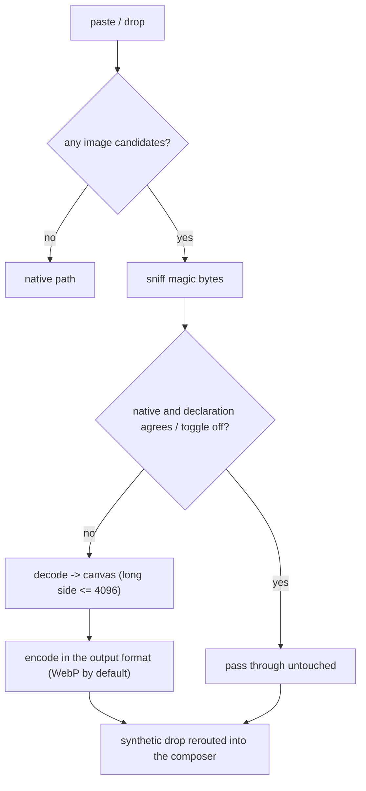

# How it works

This page explains how dsh-paste-image gets almost any image — even one with a mislabeled type — into the DeepSeek Harness composer when you paste or drop it. It follows [`how-it-works.md`](how-it-works.md) and reflects the current implementation: PNG / JPEG / WebP output, per-format conversion toggles, and settings stored in the browser's `localStorage`.

> 📖 **Orientation:** this page is the user-facing flow overview; for a function-by-function code map with line references, see [Implementation details](how-it-works.md).

## Flow at a glance

```text
paste / drop (capture phase)
        |
        v
  handle(event, data)
        |  no files, over maxFiles, or no image candidate -> return, native path
        |  preventDefault() + stopPropagation()
        v
  for each candidate file -> normalize(file)
        | sniff(bytes) -> real format
        | native format and declaration agrees -> null (file kept untouched)
        | declared type empty -> retype the File, no re-encode
        v
  toCanvas()
        | XPM       -> decodeXpm()
        | SVG       -> loadSvg() +  rasterisation
        | BMP / DIB -> createImageBitmap(), fallback decodeBmp()
        |              (embedded JPEG/PNG data unwrapped first)
        | ICO / CUR -> createImageBitmap(), fallback to the largest PNG entry
        | everything else -> createImageBitmap()
        v
  canvasOf()   long side clamped to maxSide (4096 by default)
        v
  encodeCanvas()  canvas.toBlob(profile.mime[, quality])
        v
  new File(name.<ext>, type taken from the actual blob.type)
        v
  reroute(files) -> synthetic DragEvent('drop') on [data-composer-card]
```



## 1. Capture phase

The plugin listens for `paste` and `drop` on `document` in capture mode (`addEventListener(..., true)`). Capture travels from `document` down to the target, so the plugin sees the event before the composer's own handler; if a conversion happens, it can call `preventDefault()` before the composer reads `clipboardData`.

## 2. Pre-checks and skip conditions

`handle()` returns early, without claiming the event, when:

- The master switch is off (`enabled === false`): listeners stay installed and take effect immediately when re-enabled.
- The event already carries the `REROUTED` marker: avoids recursion from the plugin seeing its own synthetic event.
- There are no files or more than `maxFiles` (default 8, configurable 1–8): the whole batch goes to the native path, with no partial conversion.
- No file is an image candidate: the declared type must start with `image/` or the filename must end in an image extension; plain-text pastes never match.
- `DataTransfer` / `DragEvent` constructors are missing, or the composer card (`[data-composer-card]`) cannot be found: the plugin lets go and the browser's native path continues.

Each candidate file is converted in its own `try/catch`; on failure the original file is kept.

## 3. Magic-byte detection

`sniff()` reads the leading bytes and returns the real format by signature: PNG, JPEG, GIF, WebP (RIFF + WEBP), BMP (`BM` or a headerless DIB `BITMAPINFOHEADER`), TIFF (II/MM), XPM (`/* XPM */`), AVIF / HEIC (`ftyp` brand), ICO/CUR (`00 00 01 00` / `00 00 02 00`), SVG (starts with `<` and contains `<svg` within the first 1 KiB). It returns `null` when nothing matches. A headerless DIB is checked for header length, width/height signs and bit depth first, so random binary data is not mistaken for an image.

## 4. Pass-through

`normalize()` reads only the first 1024 bytes of the header to decide whether to touch the whole file:

- The conversion toggle for that format is off: the original file passes through without even reading the full bytes.
- A native type (PNG/JPEG/WebP/GIF) whose declaration agrees with the real bytes: passes through after reading the 1 KiB header. Real screenshots therefore keep their bytes, metadata and animation completely unchanged.
- The declared type is empty: the bytes are rewrapped in a `File` with the sniffed type (no re-encode), so it passes the host's whitelist.
- The declared type disagrees with the real bytes (e.g. BMP claiming PNG): it is converted and re-encoded to the selected output format.

On conversion the extension is replaced with the actual encoding (`shot.xpm` -> `shot.png`); retyped native files keep their own extension. A MIME alias table (`image/jpg`, `image/x-png`, `image/svg+xml`, etc.) normalises spellings first, so healthy files are not needlessly re-encoded.

## 5. Decoding and encoding

Decoding paths: XPM uses the built-in decoder; SVG is rasterised via `` (Chromium has no `createImageBitmap()` for SVG blobs); everything else goes to `createImageBitmap()`, with BMP falling back to `decodeBmp()` or unwrapping embedded JPEG/PNG, and ICO falling back to the largest PNG entry. Size is scaled by `scale = min(1, maxSide / longest side)`; small images pass through unchanged.

Encoding is handled by `encodeCanvas()`: PNG is lossless and passes no quality parameter; JPEG is first composited onto an opaque white background (transparent pixels do not turn black), WebP keeps transparency, and both carry `quality`. The final type is taken from the browser's actual `blob.type`, falling back to PNG if unrecognised.

## 6. Rerouting

`reroute()` puts the converted files into a `DataTransfer` and dispatches a synthetic `drop` event (with a non-enumerable `REROUTED` marker) on the real composer card. This reuses the same attachment path as a manual drop, so no private composer API is needed; if no card is found, nothing is dispatched.

## 7. Failure handling and logs

Conversion runs per file in a `try/catch`. Success logs a line such as `image/xpm -> image/png 1440x900`; failure logs `keep original (image/bmp): ...` and keeps the original file — one bad file never blocks the others, the synthetic drop still happens, and the result is the host's usual error rather than silence. Logs go through `console.debug`, so the browser console must be set to Verbose to see them.

## 8. Settings and the configuration page

Settings live only in the browser's `localStorage` (key `dsh-paste-image.settings.v1`; in private mode or when disabled, an in-memory copy is used and pasting still works). Open them from the primary entry **Settings → Paste any image**, which shows the full form below directly; the original plugin-row entry (Settings → Plugins → dsh-paste-image → Configure) remains and both share the same settings. You can also change them via `api.getSettings()` / `api.applySettings(patch)` / `api.resetSettings()`.

| Setting          | Default | Value / range           | Effect                                                                  |
| ---------------- | ------- | ----------------------- | ----------------------------------------------------------------------- |
| `enabled`        | `true`  | boolean                 | Master switch; when off, pasting uses the native path                   |
| `maxFiles`       | `8`     | integer 1–8             | Max files per batch; over the limit the whole batch passes through      |
| `maxSide`        | `4096`  | integer 512–8192        | Long-side limit of converted images                                     |
| `outputFormat`   | `webp`  | `png` / `jpeg` / `webp` | Output format for conversion (falls back to PNG if unsupported)         |
| `quality`        | `0.92`  | 0.1–1 (2 decimals)      | JPEG / WebP encoding quality; disabled in the form when PNG is selected |
| `convertXpm`     | `true`  | boolean                 | Whether to convert XPM                                                  |
| `convertBmp`     | `true`  | boolean                 | Whether to convert BMP / DIB                                            |
| `convertSvg`     | `true`  | boolean                 | Whether to convert SVG                                                  |
| `convertIco`     | `true`  | boolean                 | Whether to convert ICO / CUR                                            |
| `logConversions` | `true`  | boolean                 | Whether to emit conversion debug logs                                   |

> 💡 **Form behaviour:** drafts live in component state and are written only when you click "Save"; "Restore defaults" returns to the table's values.

## 9. Limits and unsupported cases

- **HEIC / TIFF**: signatures are recognised but not decoded (no built-in decoder), so files are left as-is.
- **XPM**: XPM1/XPM2 header layouts and non-`c` colour keys are unsupported; palette names that are not valid CSS colours (such as the two-word `light gray`) render opaque black, while `None` is fully transparent.
- **BMP / DIB**: supports header sizes 12/40/52/56/64/108/124, bit depths 1/4/8/16/24/32, BI_RGB / RLE8 / RLE4 / BITFIELDS / ALPHABITFIELDS compression, embedded JPEG/PNG and top-down bitmaps; images over 64 Mi pixels are rejected before memory allocation. All-zero 32-bit alpha is treated as opaque.
- **ICO / CUR**: only icons containing a PNG entry are supported (the largest by area); DIB-only icons and cursors are not.
- **Native formats**: PNG, JPEG, WebP and GIF whose declaration matches the real bytes are never re-encoded.
- **Size reference**: photos are about 82% smaller with JPEG/WebP; UI screenshots are often smaller with PNG. See [output-format measurements](output-formats.md).

## 10. Design principles

Bytes over labels; synchronous cancellation in the capture phase; WebP as the default output (whitelisted, keeps transparency with a small footprint, universal in Chromium); a synthetic drop instead of a private API; no host process and no third-party decoders.
