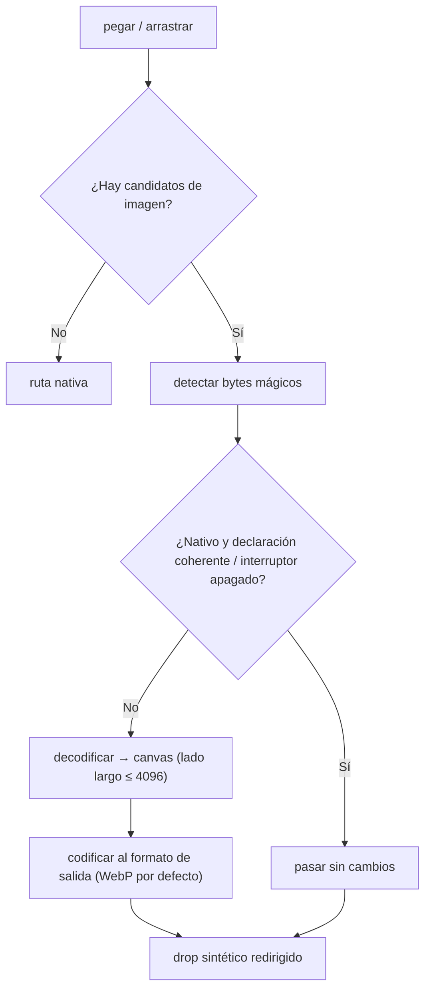

# Cómo funciona

Esta página explica cómo dsh-paste-image introduce casi cualquier imagen —incluso una cuyo tipo está mal etiquetado— en el compositor de DeepSeek Harness al pegarla o arrastrarla. Se basa en [`how-it-works.md`](how-it-works.md) y refleja la implementación actual: salida PNG / JPEG / WebP, interruptores de conversión por formato y ajustes guardados en el `localStorage` del navegador.

> 📖 **Propósito:** esta página es una visión general del flujo orientada al usuario; el mapa del código función por función con referencias a líneas está en [Cómo funciona](how-it-works.md).

## Resumen del flujo

```text
pegar / arrastrar (fase de captura)
        |
        v
  handle(event, data)
        |  sin archivos, más de maxFiles o ningún candidato de imagen -> salir, ruta nativa
        |  preventDefault() + stopPropagation()
        v
  para cada archivo candidato -> normalize(file)
        | sniff(bytes) -> formato real
        | formato nativo y declaración coincidente -> null (archivo intacto)
        | tipo declarado vacío -> retipar el File, sin recodificar
        v
  toCanvas()
        | XPM       -> decodeXpm()
        | SVG       -> loadSvg() + rasterización con 
        | BMP / DIB -> createImageBitmap(), reserva decodeBmp()
        |              (los datos JPEG/PNG incrustados se desenvuelven primero)
        | ICO / CUR -> createImageBitmap(), reserva la entrada PNG más grande
        | otros     -> createImageBitmap()
        v
  canvasOf()   lado largo limitado a maxSide (4096 por defecto)
        v
  encodeCanvas()  canvas.toBlob(profile.mime[, quality])
        v
  new File(name.<ext>, tipo tomado del blob.type real)
        v
  reroute(files) -> DragEvent('drop') sintético en [data-composer-card]
```



## 1. Fase de captura

El plugin escucha `paste` y `drop` en `document` en modo de captura (`addEventListener(..., true)`). La captura va de `document` hacia el objetivo, así que el plugin ve el evento antes del controlador propio del compositor; si hay conversión, puede llamar a `preventDefault()` antes de que el compositor lea `clipboardData`.

## 2. Comprobaciones previas y condiciones de salto

`handle()` sale anticipadamente, sin reclamar el evento, cuando:

- El interruptor general está apagado (`enabled === false`): los escuchadores siguen instalados y surten efecto al reactivarlo.
- El evento ya lleva la marca `REROUTED`: evita la recursión de que el plugin vea su propio evento sintético.
- No hay archivos o hay más de `maxFiles` (8 por defecto, configurable de 1 a 8): todo el lote va a la ruta nativa, sin conversiones parciales.
- Ningún archivo es candidato de imagen: el tipo declarado debe empezar por `image/` o el nombre debe terminar en una extensión de imagen; un pegado de texto plano nunca coincide.
- Faltan los constructores `DataTransfer` / `DragEvent`, o no se encuentra la tarjeta del compositor (`[data-composer-card]`): el plugin se aparta y continúa la ruta nativa del navegador.

Cada archivo candidato se convierte en su propio `try/catch`; si falla, se conserva el archivo original.

## 3. Detección por bytes mágicos

`sniff()` lee los bytes iniciales y devuelve el formato real según la firma: PNG, JPEG, GIF, WebP (RIFF + WEBP), BMP (`BM` o un DIB sin cabecera de archivo `BITMAPINFOHEADER`), TIFF (II/MM), XPM (`/* XPM */`), AVIF / HEIC (brand `ftyp`), ICO/CUR (`00 00 01 00` / `00 00 02 00`), SVG (empieza por `<` y contiene `<svg` en el primer KiB). Devuelve `null` si nada coincide. Un DIB sin cabecera se comprueba primero por longitud de cabecera, signos de ancho/alto y profundidad de bits, para que datos binarios aleatorios no se confundan con una imagen.

## 4. Paso sin cambios

`normalize()` lee solo los primeros 1024 bytes de la cabecera para decidir si toca el archivo completo:

- El interruptor de conversión de ese formato está apagado: el archivo original pasa sin leer siquiera los bytes completos.
- Un tipo nativo (PNG/JPEG/WebP/GIF) cuya declaración coincide con los bytes reales: pasa tras leer la cabecera de 1 KiB. Las capturas reales conservan por completo sus bytes, metadatos y animación.
- El tipo declarado está vacío: los bytes se reenvuelven en un `File` con el tipo detectado (sin recodificar), para que pase el filtro del host.
- El tipo declarado no coincide con los bytes reales (p. ej. BMP que dice ser PNG): se convierte y se recodifica al formato de salida elegido.

Al convertir, la extensión se sustituye por la codificación real (`shot.xpm` -> `shot.png`); los archivos nativos retipados conservan su extensión. Una tabla de alias MIME (`image/jpg`, `image/x-png`, `image/svg+xml`, etc.) normaliza las grafías primero, para que los archivos correctos no se recodifiquen sin necesidad.

## 5. Decodificación y codificación

Rutas de decodificación: XPM usa el decodificador integrado; SVG se rasteriza con `` (Chromium no tiene `createImageBitmap()` para blobs SVG); todo lo demás usa `createImageBitmap()`, con BMP como reserva `decodeBmp()` o desenvuelve JPEG/PNG incrustados, e ICO como reserva la entrada PNG más grande. El tamaño se escala con `scale = min(1, maxSide / lado más largo)`; las imágenes pequeñas pasan sin cambios.

La codificación la gestiona `encodeCanvas()`: PNG es sin pérdidas y no pasa parámetro de calidad; JPEG se compone primero sobre un fondo blanco opaco (los píxeles transparentes no se vuelven negros), WebP conserva la transparencia, y ambos llevan `quality`. El tipo final se toma del `blob.type` real del navegador, con PNG como reserva si no se reconoce.

## 6. Redirección

`reroute()` coloca los archivos convertidos en un `DataTransfer` y despacha un evento `drop` sintético (con una marca `REROUTED` no enumerable) en la tarjeta real del compositor. Esto reutiliza la misma ruta de adjuntos que un arrastrar manual, sin necesidad de APIs privadas; si no se encuentra la tarjeta, no se despacha nada.

## 7. Gestión de fallos y registros

La conversión se ejecuta por archivo en un `try/catch`. El éxito registra una línea como `image/xpm -> image/png 1440x900`; el fallo registra `keep original (image/bmp): ...` y conserva el archivo original: un archivo malo nunca bloquea a los demás, el drop sintético sigue ocurriendo y el resultado es el error habitual del host, no un silencio. Los registros van por `console.debug`, así que hay que poner la consola del navegador en Verbose para verlos.

## 8. Ajustes y página de configuración

Los ajustes solo viven en el `localStorage` del navegador (clave `dsh-paste-image.settings.v1`; en modo privado o si está desactivado se usa una copia en memoria y el pegado sigue funcionando). La entrada principal es **Ajustes → Pegar cualquier imagen**, que muestra directamente el formulario completo de abajo; la entrada anterior en la fila del plugin (Ajustes → Extensiones → dsh-paste-image → Configuración) sigue disponible y ambas comparten los mismos ajustes. También puedes cambiarlos mediante `api.getSettings()` / `api.applySettings(patch)` / `api.resetSettings()`.

| Ajuste           | Valor por defecto | Valor / rango           | Efecto                                                                    |
| ---------------- | ----------------- | ----------------------- | ------------------------------------------------------------------------- |
| `enabled`        | `true`            | booleano                | Interruptor general; apagado, el pegado usa la ruta nativa                |
| `maxFiles`       | `8`               | entero 1–8              | Máximo de archivos por lote; al superarse, todo el lote pasa sin cambios  |
| `maxSide`        | `4096`            | entero 512–8192         | Límite del lado largo de las imágenes convertidas                         |
| `outputFormat`   | `webp`            | `png` / `jpeg` / `webp` | Formato de salida de la conversión (PNG si no es compatible)              |
| `quality`        | `0.92`            | 0.1–1 (2 decimales)     | Calidad de codificación JPEG / WebP; desactivado en el formulario con PNG |
| `convertXpm`     | `true`            | booleano                | Si convertir XPM                                                          |
| `convertBmp`     | `true`            | booleano                | Si convertir BMP / DIB                                                    |
| `convertSvg`     | `true`            | booleano                | Si convertir SVG                                                          |
| `convertIco`     | `true`            | booleano                | Si convertir ICO / CUR                                                    |
| `logConversions` | `true`            | booleano                | Si emitir registros de depuración de conversiones                         |

> 💡 **Comportamiento del formulario:** los borradores viven en el estado del componente; solo al pulsar «Guardar» se escriben los ajustes. «Restaurar valores predeterminados» vuelve a los valores de la tabla.

## 9. Límites y casos no compatibles

- **HEIC / TIFF**: las firmas se reconocen pero no se decodifican (no hay decodificador integrado), así que los archivos quedan intactos.
- **XPM**: no se admiten cabeceras XPM1/XPM2 ni claves de color distintas de `c`; los nombres de paleta que no son colores CSS válidos (como `light gray`, dos palabras) se muestran en negro opaco; `None` es totalmente transparente.
- **BMP / DIB**: admite longitudes de cabecera 12/40/52/56/64/108/124, profundidades 1/4/8/16/24/32, compresión BI_RGB / RLE8 / RLE4 / BITFIELDS / ALPHABITFIELDS, JPEG/PNG incrustados y mapas de bits de arriba abajo; las imágenes de más de 64 Mi píxeles se rechazan antes de asignar memoria. Un canal alfa 32 bits todo a cero se trata como opaco.
- **ICO / CUR**: solo se admiten iconos con una entrada PNG (la de mayor área); los iconos solo DIB y los cursores no.
- **Formatos nativos**: PNG, JPEG, WebP y GIF con declaración coherente con los bytes reales nunca se recodifican.
- **Referencia de tamaño**: las fotos son ≈82 % más pequeñas con JPEG/WebP; las capturas de interfaz suelen serlo más con PNG. Consulta [mediciones de formatos de salida](output-formats.md).

## 10. Principios de diseño

Los bytes por encima de las etiquetas; cancelación sincrónica en la fase de captura; WebP como salida predeterminada (en la lista blanca, conserva transparencia y es compacta, universal en Chromium); un drop sintético en lugar de una API privada; sin proceso de host y sin decodificadores de terceros.
