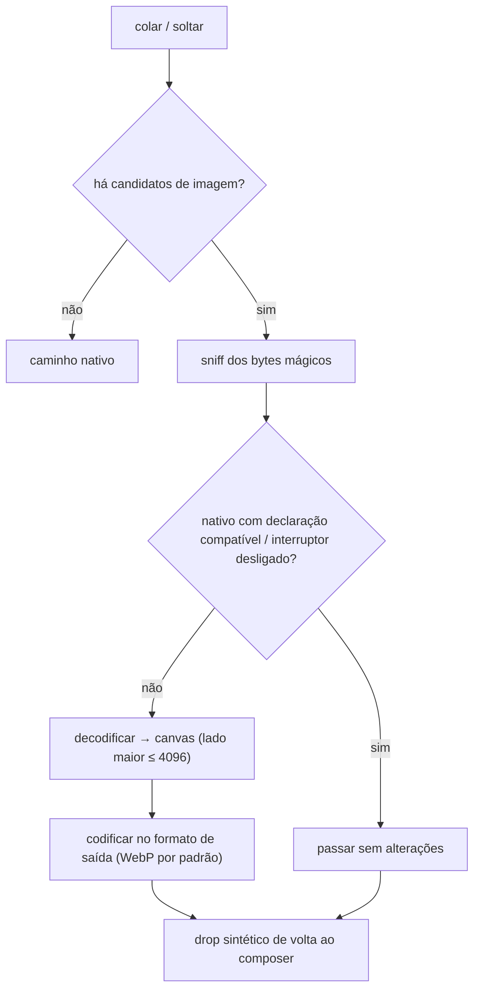

# Como funciona

Esta página explica como o dsh-paste-image insere no compositor do DeepSeek Harness quase qualquer imagem — mesmo uma com o tipo declarado incorreto — quando você a cola ou arrasta. Ela segue [`how-it-works.md`](how-it-works.md) e reflete a implementação atual: saída PNG / JPEG / WebP, interruptores de conversão por formato e configurações armazenadas no `localStorage` do navegador.

> 📖 **Posicionamento:** esta página é uma visão geral do fluxo voltada ao usuário; o mapa do código função por função com referências de linha está em [Como funciona](how-it-works.md).

## Resumo do fluxo

```text
colar / arrastar (fase de captura)
        |
        v
  handle(event, data)
        |  sem arquivos, mais de maxFiles ou nenhum candidato de imagem -> sair, caminho nativo
        |  preventDefault() + stopPropagation()
        v
  para cada arquivo candidato -> normalize(file)
        | sniff(bytes) -> formato real
        | formato nativo e declaração compatível -> null (arquivo intacto)
        | tipo declarado vazio -> retipar o File, sem recodificar
        v
  toCanvas()
        | XPM       -> decodeXpm()
        | SVG       -> loadSvg() + rasterização via 
        | BMP / DIB -> createImageBitmap(), reserva decodeBmp()
        |              (dados JPEG/PNG incorporados são desembrulhados primeiro)
        | ICO / CUR -> createImageBitmap(), reserva a maior entrada PNG
        | demais    -> createImageBitmap()
        v
  canvasOf()   lado maior limitado a maxSide (4096 por padrão)
        v
  encodeCanvas()  canvas.toBlob(profile.mime[, quality])
        v
  new File(name.<ext>, tipo obtido do blob.type real)
        v
  reroute(files) -> DragEvent('drop') sintético em [data-composer-card]
```



## 1. Fase de captura

O plugin escuta `paste` e `drop` em `document` no modo de captura (`addEventListener(..., true)`). A captura vai de `document` até o alvo, então o plugin vê o evento antes do manipulador próprio do compositor; se houver conversão, ele pode chamar `preventDefault()` antes de o compositor ler `clipboardData`.

## 2. Verificações prévias e condições de ignorar

`handle()` retorna imediatamente, sem assumir o evento, quando:

- O interruptor geral está desligado (`enabled === false`): os ouvintes permanecem instalados e voltam a atuar assim que reativado.
- O evento já traz a marcação `REROUTED`: evita a recursão de o plugin ver seu próprio evento sintético.
- Não há arquivos ou há mais de `maxFiles` (8 por padrão, configurável de 1 a 8): todo o lote segue o caminho nativo, sem conversão parcial.
- Nenhum arquivo é candidato de imagem: o tipo declarado deve começar com `image/` ou o nome do arquivo deve terminar em uma extensão de imagem; colar texto simples nunca corresponde.
- Os construtores `DataTransfer` / `DragEvent` estão ausentes, ou o cartão do compositor (`[data-composer-card]`) não é encontrado: o plugin desiste e o caminho nativo do navegador continua.

Cada arquivo candidato é convertido em seu próprio `try/catch`; em caso de falha, o arquivo original é mantido.

## 3. Detecção por bytes mágicos

`sniff()` lê os bytes iniciais e determina o formato real pela assinatura: PNG, JPEG, GIF, WebP (RIFF + WEBP), BMP (`BM` ou um DIB sem cabeçalho de arquivo `BITMAPINFOHEADER`), TIFF (II/MM), XPM (`/* XPM */`), AVIF / HEIC (brand `ftyp`), ICO/CUR (`00 00 01 00` / `00 00 02 00`), SVG (começa com `<` e contém `<svg` no primeiro KiB). Retorna `null` quando nada corresponde. Um DIB sem cabeçalho de arquivo é verificado primeiro quanto ao tamanho do cabeçalho, aos sinais de largura/altura e à profundidade de bits, para que dados binários aleatórios não sejam confundidos com uma imagem.

## 4. Passagem sem alterações

`normalize()` lê apenas os primeiros 1024 bytes do cabeçalho para decidir se deve tocar no arquivo inteiro:

- O interruptor de conversão desse formato está desligado: o arquivo original passa sem nem ler os bytes completos.
- Um tipo nativo (PNG/JPEG/WebP/GIF) cuja declaração coincide com os bytes reais: passa após a leitura do cabeçalho de 1 KiB. Capturas de tela reais mantêm assim bytes, metadados e animação completamente inalterados.
- O tipo declarado está vazio: os bytes são reembalados em um `File` com o tipo detectado (sem recodificação), para passar pela lista de permissões do host.
- O tipo declarado discorda dos bytes reais (por exemplo, BMP se dizendo PNG): ele é convertido e recodificado no formato de saída escolhido.

Na conversão, a extensão é substituída pela codificação real (`shot.xpm` → `shot.png`); arquivos nativos retipados mantêm sua extensão. Uma tabela de aliases MIME (`image/jpg`, `image/x-png`, `image/svg+xml`, etc.) normaliza as grafias primeiro, para que arquivos íntegros não sejam recodificados sem necessidade.

## 5. Decodificação e codificação

Caminhos de decodificação: XPM usa o decodificador integrado; SVG é rasterizado via `` (o Chromium não tem `createImageBitmap()` para blobs SVG); todo o resto vai para `createImageBitmap()`, com BMP recorrendo a `decodeBmp()` ou desembrulhando JPEG/PNG incorporados, e ICO recorrendo à maior entrada PNG. O tamanho é escalado por `scale = min(1, maxSide / lado maior)`; imagens pequenas passam sem alteração.

A codificação é feita por `encodeCanvas()`: PNG é sem perdas e não recebe parâmetro de qualidade; JPEG é primeiro composto sobre um fundo branco opaco (pixels transparentes não ficam pretos), WebP preserva a transparência, e ambos recebem `quality`. O tipo final vem do `blob.type` real do navegador, com reserva para PNG se não for reconhecido.

## 6. Redirecionamento

`reroute()` coloca os arquivos convertidos em um `DataTransfer` e dispara um evento `drop` sintético (com uma marcação `REROUTED` não enumerável) no cartão real do compositor. Isso reutiliza o mesmo caminho de anexos de um arrasto manual, sem APIs privadas do compositor; se nenhum cartão for encontrado, nada é disparado.

## 7. Tratamento de falhas e registros

A conversão roda por arquivo em um `try/catch`. O sucesso registra uma linha como `image/xpm -> image/png 1440x900`; a falha registra `keep original (image/bmp): ...` e mantém o arquivo original — um arquivo ruim nunca bloqueia os outros, o drop sintético ainda acontece, e o resultado é o erro usual do host, em vez de silêncio. Os registros passam por `console.debug`, então o console do navegador precisa estar em Verbose para vê-los.

## 8. Configurações e página de configuração

As configurações vivem apenas no `localStorage` do navegador (chave `dsh-paste-image.settings.v1`; no modo privado ou quando o armazenamento está desativado, uma cópia em memória é usada e a colagem continua funcionando). A entrada principal é **Configurações → Colar qualquer imagem**, que abre diretamente o formulário completo abaixo; a entrada anterior pela linha do plugin (Configurações → Extensões → dsh-paste-image → Configurar) continua disponível e ambas compartilham as mesmas configurações. Você também pode alterá-las via `api.getSettings()` / `api.applySettings(patch)` / `api.resetSettings()`.

| Configuração     | Padrão | Valor / faixa           | Efeito                                                                  |
| ---------------- | ------ | ----------------------- | ----------------------------------------------------------------------- |
| `enabled`        | `true` | booleano                | Interruptor geral; desligado, a colagem usa o caminho nativo            |
| `maxFiles`       | `8`    | inteiro 1–8             | Máx. de arquivos por lote; acima disso, todo o lote passa sem alteração |
| `maxSide`        | `4096` | inteiro 512–8192        | Limite do lado maior das imagens convertidas                            |
| `outputFormat`   | `webp` | `png` / `jpeg` / `webp` | Formato de saída da conversão (PNG se não suportado)                    |
| `quality`        | `0.92` | 0.1–1 (2 casas)         | Qualidade de codificação JPEG / WebP; desativado no formulário com PNG  |
| `convertXpm`     | `true` | booleano                | Converter ou não XPM                                                    |
| `convertBmp`     | `true` | booleano                | Converter ou não BMP / DIB                                              |
| `convertSvg`     | `true` | booleano                | Converter ou não SVG                                                    |
| `convertIco`     | `true` | booleano                | Converter ou não ICO / CUR                                              |
| `logConversions` | `true` | booleano                | Emitir ou não registros de depuração das conversões                     |

> 💡 **Comportamento do formulário:** os rascunhos ficam no estado do componente e só são gravados ao clicar em "Salvar"; "Restaurar padrões" volta aos valores da tabela.

## 9. Limites e casos não suportados

- **HEIC / TIFF**: as assinaturas são reconhecidas, mas não decodificadas (sem decodificador integrado), então os arquivos ficam como estão.
- **XPM**: não há suporte a layouts de cabeçalho XPM1/XPM2 nem a chaves de cor diferentes de `c`; nomes de paleta que não são cores CSS válidas (como `light gray`, com duas palavras) saem em preto opaco; `None` é totalmente transparente.
- **BMP / DIB**: suporta tamanhos de cabeçalho 12/40/52/56/64/108/124, profundidades 1/4/8/16/24/32, compressão BI_RGB / RLE8 / RLE4 / BITFIELDS / ALPHABITFIELDS, JPEG/PNG incorporados e bitmaps de cima para baixo; imagens com mais de 64 Mi pixels são rejeitadas antes da alocação de memória. Um canal alfa 32 bits todo zerado é tratado como opaco.
- **ICO / CUR**: apenas ícones com uma entrada PNG são suportados (a maior por área); ícones só com DIB e cursores não.
- **Formatos nativos**: PNG, JPEG, WebP e GIF cuja declaração corresponde aos bytes reais nunca são recodificados.
- **Referência de tamanho**: fotos ficam cerca de 82 % menores com JPEG/WebP; capturas de interface costumam ser menores com PNG. Veja [medições dos formatos de saída](output-formats.md).

## 10. Princípios de design

Bytes antes de rótulos; cancelamento síncrono na fase de captura; WebP como saída padrão (na lista de permissões, preserva transparência e compacta, universal no Chromium); drop sintético em vez de API privada; sem processo host e sem decodificadores de terceiros.
